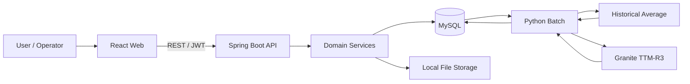
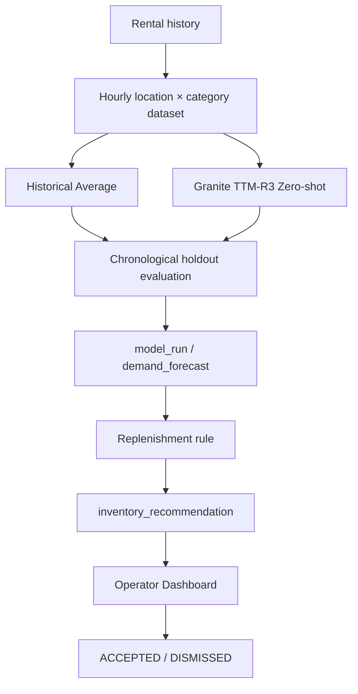
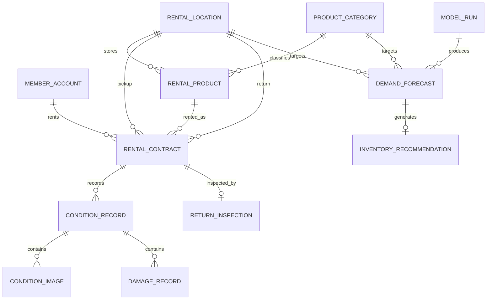

# RentalTrack

이동 중 필요한 생활용품을 주변 대여 지점에서 탐색하고 대여·반납할 수 있는 웹 기반 렌탈 서비스입니다. 대여 전·후 상태와 사진을 대여 건별로 기록해 상품 이력을 보존하고, 축적된 이용 데이터를 지점·상품별 수요 예측으로 연결해 운영자의 재고 배치 판단을 지원합니다.

## 1. 프로젝트 개요

| 항목 | 내용 |
| --- | --- |
| 프로젝트 | RentalTrack |
| 기간 | 2026.10 |
| 형태 | 개인 포트폴리오 프로젝트 |
| 핵심 주제 | 렌탈 상태 이력 관리 및 수요 예측 기반 운영 지원 |
| 주요 모델 | Historical Average, IBM Granite TTM-R3 |
| 실행 환경 | Docker Compose 기반 MySQL / Spring Boot, React + Vite, Python batch |

서비스의 핵심 흐름은 다음과 같습니다.

```text
회원가입·로그인
→ 주변 대여 지점·상품 탐색
→ 대여 신청 및 인수
→ 대여 전 상태·사진 기록
→ 이용
→ 반납 및 대여 후 상태·사진 기록
→ 손상 이력 비교 및 반납 검수
→ 대여 이력 축적
→ 지점·상품별 수요 예측
→ 재고 보충 추천
→ 운영자 승인·기각
```

## 2. 기획 의도

반복 대여되는 상품은 현재 상태만 관리하면 이전 대여 시점의 상태와 손상 이력을 확인하기 어렵습니다. 또한 대여가 누적되어도 이용 데이터를 재고 배치 판단에 연결하지 않으면 운영자는 지점별·상품별 수요를 별도로 해석해야 합니다.

RentalTrack은 이 두 흐름을 하나의 서비스 안에서 연결하는 것을 목표로 설계했습니다.

- 상품의 상태를 현재 값 하나로 덮어쓰지 않고 대여 건별 BEFORE / AFTER 기록으로 보존합니다.
- 대여 계약과 상품 상태를 별도 lifecycle로 관리해 상태 전이의 책임을 분리합니다.
- 동일 상품의 동시 대여 요청을 DB lock과 transaction으로 제어합니다.
- 사진 파일과 상태 메타데이터의 저장 책임을 분리합니다.
- 대여 이력을 시간 단위 수요 데이터로 변환해 Historical Average와 TTM-R3를 비교합니다.
- AI는 수요만 예측하고, 재고 보충 수량은 별도 운영 규칙으로 계산합니다.
- 최종 추천은 자동 실행하지 않고 운영자가 승인하거나 기각하도록 구성합니다.

## 3. 주요 기능

### 회원 및 인증

- 이메일·비밀번호 회원가입 및 로그인
- BCrypt 기반 비밀번호 hash 저장
- JWT access token 발급 및 검증
- Spring Security 기반 stateless 인증
- USER / OPERATOR 권한 분리
- 요청마다 DB의 ACTIVE 상태와 현재 role 재확인

### 렌탈 및 상태 이력

- 대여 지점·상품 탐색
- 대여 신청, 인수, 이용 시작, 반납
- RentalContract / RentalProduct 상태 전이 분리
- 대여 건별 BEFORE_RENTAL / AFTER_RENTAL 상태 기록
- 대여 이력 페이지 조회
- 동일 상품 동시 대여 요청 제어

### 사진·손상·반납 검수

- 상태 기록별 이미지 업로드
- Local File Storage adapter와 ImageStorage port 분리
- 대여 전·후 DamageRecord 비교
- 기존 손상과 신규 손상 구분
- ReturnInspection 결과에 따라 AVAILABLE / MAINTENANCE 전환

### 수요 예측 및 재고 추천

- 지점 × 상품 카테고리 × 1시간 단위 시계열 생성
- Historical Average baseline
- IBM Granite TTM-R3 zero-shot forecasting
- 시간순 holdout 기반 MAE / RMSE 비교
- model_run / demand_forecast 결과 저장
- 현재 가용 수량과 safety stock을 반영한 inventory_recommendation 생성

### 운영자 Dashboard

- 최신 모델 실행 정보 확인
- 모델별 MAE / RMSE 비교
- 지점·카테고리별 예측 수요 확인
- 미처리 추천과 위험도 분포 확인
- 추가 배치 권장 수량 확인
- 우선 검토 recommendation 조회
- ACCEPTED / DISMISSED 의사결정 기록

## 4. 기술 스택

| 영역 | 기술 |
| --- | --- |
| Backend | Java 21, Spring Boot 4.1.0, Spring MVC, Spring Data JPA, Spring Security, Gradle |
| Database | MySQL 8.4, Flyway |
| Frontend | React 18, TypeScript 5.6, Vite 5, React Router, Axios |
| Authentication | BCrypt, JWT |
| Data / AI | Python 3.11, NumPy, Pandas, IBM Granite TTM-R3 |
| Test | JUnit, Spring Boot Test, MySQL Integration Test, Pytest |
| Runtime / CI | Docker Compose, GitHub Actions |

## 5. 시스템 아키텍처



사용자 요청은 React → Spring Boot → MySQL 흐름으로 처리합니다. 이미지 파일은 DB와 분리된 Local File Storage에 저장하고, DB에는 storage key와 파일 메타데이터만 보존합니다.

수요 예측은 사용자 요청마다 실행하지 않습니다. Python batch가 MySQL의 운영 데이터를 읽어 예측을 수행하고 결과를 다시 MySQL에 저장하면 Spring Boot가 이를 운영자 API와 Dashboard에 제공합니다.

## 6. 상태·이력 및 동시성 설계

대여 계약과 상품은 서로 다른 상태를 가집니다.

```text
RentalContract
REQUESTED
→ APPROVED
→ PICKED_UP
→ IN_USE
→ RETURNED
→ INSPECTING
→ COMPLETED
```

```text
RentalProduct
AVAILABLE
→ RESERVED
→ RENTED
→ INSPECTION
→ AVAILABLE or MAINTENANCE
```

상품의 현재 상태만 갱신하지 않고 한 대여 건 안에 대여 전·후 상태를 분리해 보존합니다.

```text
RentalContract
├─ BEFORE_RENTAL ConditionRecord
│  ├─ ConditionImage[]
│  └─ DamageRecord[]
├─ AFTER_RENTAL ConditionRecord
│  ├─ ConditionImage[]
│  └─ DamageRecord[]
└─ ReturnInspection
```

동일 상품에 여러 사용자가 동시에 대여를 요청하는 경우 RentalProduct 조회에 `PESSIMISTIC_WRITE` lock을 적용해 하나의 요청만 AVAILABLE 상태를 RESERVED로 바꿀 수 있도록 처리했습니다.

상세 설계는 [도메인 모델](docs/DOMAIN.md)과 [ERD](docs/ERD.md)에 정리되어 있습니다.

## 7. 수요 예측 및 운영 지원

### 예측 흐름



예측 모델과 운영 규칙은 분리했습니다.

```text
Model
→ predicted demand

Rule
→ predicted demand
 + available quantity
 + safety stock
→ recommended additional quantity
→ risk level

Operator
→ ACCEPTED / DISMISSED
```

### Baseline과 TTM-R3 비교

실험에는 서비스 운영 데이터가 아닌 pipeline 검증용 합성 데이터를 사용했습니다.

```text
dataset_version: synthetic-v1-seed42-720h
locations: 2
categories: 2
series: 4
hours per series: 720
rows: 2,880
holdout: final 24 hours
```

| Model | MAE | RMSE |
| --- | ---: | ---: |
| Historical Average | 1.111979 | 1.430918 |
| Granite TTM-R3 zero-shot | **1.044682** | **1.410518** |

이번 합성 데이터 실행에서는 TTM-R3의 MAE와 RMSE가 모두 낮았습니다. 이 결과는 데이터 파이프라인과 모델 연결을 검증한 한 번의 합성 데이터 실험이며, 실제 서비스 수요에 대한 일반화 성능을 의미하지 않습니다.

상세 내용은 [수요 예측 실험](docs/DEMAND-FORECAST-EXPERIMENT.md)과 [실험 결과](docs/PHASE4-EXPERIMENT-RESULT.md)에 정리되어 있습니다.

## 8. 데이터 구조

주요 데이터 관계는 다음과 같습니다.



Flyway migration은 `V1`부터 `V10`까지 순차 적용하며 Spring Boot 시작 시 Hibernate `ddl-auto=validate`로 Entity와 DB schema 정합성을 확인합니다.

전체 관계와 제약조건은 [ERD 문서](docs/ERD.md)를 기준으로 합니다.

## 9. 프로젝트 구조

```text
RentalTrack/
├─ backend/                              # Spring Boot Backend
│  ├─ src/main/java/com/rentaltrack/
│  │  ├─ access/
│  │  ├─ auth/
│  │  ├─ catalog/
│  │  ├─ condition/
│  │  ├─ damage/
│  │  ├─ forecast/
│  │  ├─ inspection/
│  │  ├─ member/
│  │  ├─ product/
│  │  ├─ rental/
│  │  └─ storage/
│  └─ src/main/resources/
│     └─ db/migration/
│
├─ frontend/
│  └─ web/                               # React Operator Dashboard
│     └─ src/
│        ├─ auth/
│        └─ operator/
│
├─ ai/
│  └─ demand_forecasting/                # Python Forecast Pipeline
│     ├─ src/rentaltrack_ai/
│     └─ tests/
│
├─ docs/                                 # 설계·검증 문서
├─ compose.yaml
├─ .env.example
└─ README.md
```

## 10. 실행 방법

Backend와 MySQL은 Docker Compose로 실행할 수 있습니다.

### 1. 환경 파일 준비

```bash
cp .env.example .env
```

Windows PowerShell:

```powershell
Copy-Item .env.example .env
```

기본 개발 설정으로 실행할 수 있으며 배포 환경에서는 JWT secret과 DB 비밀번호를 별도 환경변수로 주입해야 합니다.

### 2. Backend / MySQL 실행

```bash
docker compose up -d --build
```

Backend 기본 주소:

```text
http://localhost:8080
```

### 3. Frontend 실행

```bash
cd frontend/web
npm install
npm run dev
```

Frontend 기본 주소:

```text
http://localhost:5173
```

Vite 개발 서버의 `/api` 요청은 `http://localhost:8080`으로 proxy됩니다.

### 4. 운영자 계정 준비

공개 회원가입은 USER role만 생성합니다. 로컬 Dashboard 확인 시 회원가입 후 DB에서 해당 계정의 role을 OPERATOR로 변경합니다.

```sql
UPDATE member_account
SET role = 'OPERATOR'
WHERE email = 'operator@example.com';
```

이후 같은 계정으로 Dashboard에 로그인합니다.

## 11. 테스트

Backend:

```bash
cd backend
./gradlew clean test --no-daemon --stacktrace
```

Frontend:

```bash
cd frontend/web
npm install
npm run build
```

AI:

```bash
cd ai/demand_forecasting
pip install -e ".[test]"
pytest -q
```

GitHub Actions에서는 검증 범위를 네 흐름으로 분리했습니다.

```text
Backend Validation
→ Java 21 + MySQL 8.4
→ Flyway / JPA validation
→ Unit / Integration Test

Frontend Validation
→ TypeScript compile
→ Vite build

AI Validation
→ Pytest
→ Synthetic baseline smoke test

Demand Forecast Experiment
→ Synthetic dataset
→ Historical Average / TTM-R3
→ MAE / RMSE
→ MySQL persistence
→ artifact export
```

## 12. 현재 범위와 한계

- 수요 예측 실험은 운영 데이터가 아닌 합성 데이터로 pipeline을 검증한 결과입니다.
- TTM-R3는 zero-shot으로 사용하며 합성 데이터 fine-tuning은 수행하지 않습니다.
- 수요 예측은 실시간 inference API가 아니라 batch 방식입니다.
- AI는 수요를 예측하며 손상 책임이나 재고 이동을 자동 확정하지 않습니다.
- 추천 승인 이후 상품 재배치 자체는 자동 실행하지 않습니다.
- 상태 이미지 파일은 현재 Local File Storage에 저장하며 S3·MinIO adapter는 포함하지 않습니다.
- JWT는 access token 중심이며 refresh token과 서버 측 token revocation은 v1 범위에서 제외했습니다.
- Frontend는 운영자 Dashboard 중심으로 구성되어 있으며 전체 사용자용 화면을 완성형 상용 서비스 수준으로 제공하는 것을 목표로 하지 않습니다.

## 13. 관련 문서

- [시스템 아키텍처](docs/ARCHITECTURE.md)
- [도메인 모델](docs/DOMAIN.md)
- [ERD](docs/ERD.md)
- [인증 / JWT](docs/AUTHENTICATION.md)
- [Phase 2 렌탈 흐름](docs/PHASE2-FLOW.md)
- [Phase 3 품질 검증](docs/PHASE3-QUALITY.md)
- [AI 아키텍처](docs/AI-ARCHITECTURE.md)
- [수요 예측 실험](docs/DEMAND-FORECAST-EXPERIMENT.md)
- [Phase 4 실험 결과](docs/PHASE4-EXPERIMENT-RESULT.md)
- [운영자 AI API](docs/OPERATOR-AI-API.md)
- [운영자 Dashboard](docs/OPERATOR-DASHBOARD.md)
- [Roadmap](docs/ROADMAP.md)
