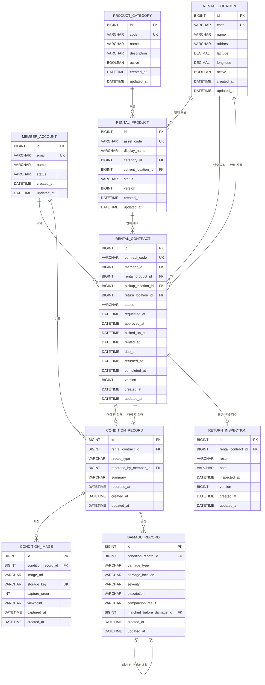

# RentalTrack ERD v1.2

Phase 1 도메인 범위는 다음 9개 엔터티로 확정합니다.

`Member / RentalLocation / ProductCategory / RentalProduct / RentalContract / ConditionRecord / ConditionImage / DamageRecord / ReturnInspection`

## 1. 관계



## 2. Member

`member_account`는 RentalTrack 사용자 계정의 최소 식별 정보만 가집니다.

```text
ACTIVE
SUSPENDED
WITHDRAWN
```

인증 비밀번호나 OAuth 식별자는 Phase 1 핵심 도메인과 분리합니다.

## 3. RentalLocation

대여소를 장치·슬롯으로 모델링하지 않고 상품을 인수·반납할 수 있는 장소로 표현합니다.

- `code`: API와 운영 데이터에서 사용할 안정적인 식별자
- `latitude / longitude`: 주변 지점 탐색과 수요 데이터 연결
- `active`: 운영 종료 시 과거 이력을 보존하기 위한 비활성화 플래그

## 4. ProductCategory / RentalProduct

상품 종류와 개별 자산을 분리합니다.

```text
ProductCategory = POWER_BANK
RentalProduct    = PB-GANGNAM-0001
RentalProduct    = PB-GANGNAM-0002
```

RentalProduct 상태:

```text
AVAILABLE
RESERVED
RENTED
INSPECTION
MAINTENANCE
RETIRED
```

## 5. RentalContract

한 회원이 한 개별 상품을 한 번 대여하는 사건입니다.

```text
REQUESTED
→ APPROVED
→ PICKED_UP
→ IN_USE
→ RETURNED
→ INSPECTING
→ COMPLETED
```

예외 상태:

```text
REJECTED
CANCELED
```

인수 지점과 반납 지점을 분리해 다른 지점 반납과 지점 간 상품 이동 이력을 수용합니다.

## 6. ConditionRecord / ConditionImage

상품 상태를 RentalProduct에 덮어쓰지 않고 **대여 건 + 시점**으로 보존합니다.

```text
RentalContract #101
├─ BEFORE_RENTAL
│  └─ ConditionImage[]
└─ AFTER_RENTAL
   └─ ConditionImage[]
```

한 대여 건에는 각 타입의 ConditionRecord가 최대 한 건만 존재합니다.

```text
UNIQUE (rental_contract_id, record_type)
```

사진 바이너리는 MySQL에 저장하지 않고 URL과 storage key를 보존합니다.

## 7. DamageRecord

DamageRecord는 특정 ConditionRecord에서 확인한 손상을 구조화합니다.

손상 유형:

```text
SCRATCH
DENT
CRACK
BROKEN
STAIN
MISSING_PART
OTHER
```

심각도:

```text
MINOR
MODERATE
SEVERE
```

비교 결과:

```text
BASELINE    # 대여 전 기록에서 이미 존재하던 손상
UNRESOLVED  # 대여 후 기록은 생성됐지만 아직 전·후 비교가 끝나지 않음
EXISTING    # 대여 전 손상과 동일하다고 확인
NEW         # 대여 후 새로 확인된 손상
```

대여 후 손상이 기존 손상으로 판정되면 `matched_before_damage_id`로 대여 전 DamageRecord를 직접 참조합니다.

예:

```text
BEFORE_RENTAL
└─ Damage A: LEFT_SIDE / SCRATCH / BASELINE

AFTER_RENTAL
├─ Damage B: LEFT_SIDE / SCRATCH / EXISTING
│             └─ matched_before_damage_id = A
└─ Damage C: HANDLE / CRACK / NEW
```

이 구조는 단순히 손상 개수를 비교하지 않고 **어떤 기존 손상이 이어졌는지**를 추적하기 위한 것입니다.

DB는 한 BEFORE 손상이 여러 AFTER 손상에 중복 매칭되지 않도록 `matched_before_damage_id`를 unique로 제한합니다.

## 8. ReturnInspection

ReturnInspection은 RentalContract 하나에 대한 최종 반납 검수 결과입니다.

Phase 1에서는 계약당 최종 검수 한 건만 유지합니다.

```text
NO_NEW_DAMAGE
NEW_DAMAGE_CONFIRMED
REVIEW_REQUIRED
```

- `NO_NEW_DAMAGE`: 신규 손상이 없음
- `NEW_DAMAGE_CONFIRMED`: 신규 손상이 확인됨
- `REVIEW_REQUIRED`: 기록이 불충분하거나 판단을 보류해야 함

DamageRecord가 개별 손상 단위의 증거라면 ReturnInspection은 **한 대여 건 전체의 최종 결론**입니다.

재검수 이력을 별도 이벤트로 남기는 구조는 Phase 1 범위에서 제외하고, 현재 행을 수정할 때 `@Version`으로 충돌을 감지합니다.

## 9. 삭제 정책

과거 대여와 상태 이력 보존이 핵심이므로 물리 삭제를 기본 운영 방식으로 사용하지 않습니다.

- Member: `WITHDRAWN`
- Location / Category: `active=false`
- Product: `RETIRED`
- Contract / Condition / Damage / Inspection: 이력 보존

FK는 `ON DELETE RESTRICT`를 사용합니다.

## 10. 동시성 기준

`RentalProduct`, `RentalContract`, `ReturnInspection`에는 JPA `@Version`을 둡니다.

- 상품: 동일 상품 대여 경쟁
- 계약: 상태 전이 경쟁
- 검수: 운영자 검수 결과 동시 수정

에 대한 optimistic locking 기반을 제공합니다.

## 11. Phase 1 데이터 흐름

```text
Member
  ↓
RentalContract
  ↓
PICKED_UP
  ↓
BEFORE_RENTAL ConditionRecord
  ├─ ConditionImage[]
  └─ DamageRecord(BASELINE)[]
  ↓
IN_USE
  ↓
AFTER_RENTAL ConditionRecord
  ├─ ConditionImage[]
  └─ DamageRecord(UNRESOLVED)[]
  ↓
전·후 비교
  ├─ EXISTING → before damage와 연결
  └─ NEW
  ↓
ReturnInspection
  ↓
RentalContract COMPLETED
```

Phase 1은 여기까지를 도메인·DB 모델의 기준선으로 확정합니다.
