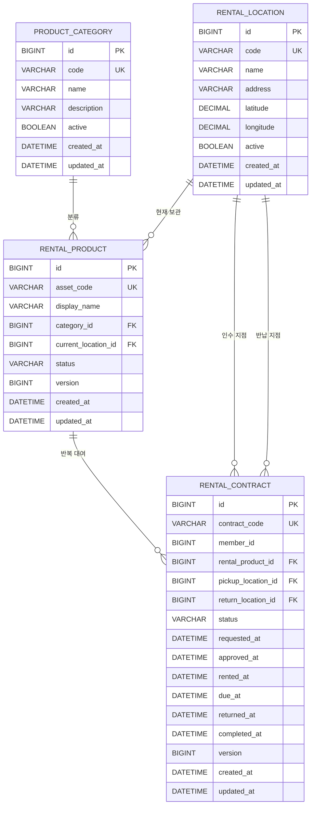

# RentalTrack ERD v1

Phase 1의 첫 번째 범위는 `RentalLocation / ProductCategory / RentalProduct / RentalContract` 네 도메인입니다.

## 1. 관계



## 2. 설계 결정

### RentalLocation

대여소를 물리 장치나 슬롯으로 모델링하지 않습니다. 웹 서비스에서 상품을 인수·반납할 수 있는 장소만 표현합니다.

- `code`: URL/API/운영 데이터에서 사용할 안정적인 식별자
- `latitude / longitude`: 주변 지점 탐색과 이후 지점 특성·수요 데이터 연결을 위해 저장
- `active`: 운영 종료 지점을 삭제하지 않고 비활성화하여 과거 대여 이력을 보존

### ProductCategory

상품 종류와 개별 상품을 분리합니다.

예:

```text
ProductCategory = POWER_BANK
RentalProduct    = PB-GANGNAM-0001
RentalProduct    = PB-GANGNAM-0002
```

카테고리는 비활성화할 수 있지만 기존 상품·계약에서 참조한 행은 삭제하지 않습니다.

### RentalProduct

같은 종류의 상품이라도 반복 대여 이력을 구분할 수 있도록 개별 자산 단위로 관리합니다.

`status`는 상품의 현재 운영 상태입니다.

```text
AVAILABLE
RESERVED
RENTED
INSPECTION
MAINTENANCE
RETIRED
```

`current_location_id`는 현재 상품이 속한 지점입니다. 대여 이력의 지점 정보는 이 값을 그대로 읽지 않고 RentalContract의 인수·반납 지점으로 별도 보존합니다.

### RentalContract

한 회원이 한 개별 상품을 한 번 대여하는 사건입니다.

```text
REQUESTED
→ APPROVED
→ IN_USE
→ RETURNED
→ INSPECTING
→ COMPLETED
```

예외 상태:

```text
REJECTED
CANCELED
```

`pickup_location_id`와 `return_location_id`를 분리하여 다른 지점 반납도 수용할 수 있게 합니다. 이는 이후 지점별 수요·재고 이동 데이터를 만드는 데도 사용합니다.

## 3. Member FK 처리

이번 migration은 네 도메인만 확정하는 단계이므로 `rental_contract.member_id` 컬럼은 만들되 FK는 아직 연결하지 않습니다.

```text
rental_contract.member_id
    ↓
Phase 1 후속 Member migration
    ↓
member.id FK 추가
```

이 방식으로 RentalContract의 데이터 모델을 다시 깨지 않고 Member 도메인을 후속 migration에서 연결합니다.

## 4. 삭제 정책

RentalTrack은 반복 대여 이력이 핵심이므로 네 테이블 모두 물리 삭제를 기본 운영 방식으로 사용하지 않습니다.

- Location / Category: `active=false`
- Product: `status=RETIRED`
- Contract: 상태 이력 보존

FK는 `ON DELETE RESTRICT`를 사용하여 과거 계약이 참조하는 상품·지점이 삭제되는 것을 막습니다.

## 5. 동시성 기준

`rental_product`와 `rental_contract`에 JPA `@Version`용 `version` 컬럼을 둡니다.

현재 Phase에서는 예약 서비스를 구현하지 않지만, 같은 상품에 동시에 대여 요청이 들어오는 상황에서 이후 optimistic locking을 적용할 수 있는 기반을 먼저 둡니다.

## 6. 다음 ERD 확장

다음 도메인은 이 구조 위에 추가합니다.

```text
Member
ConditionRecord
ConditionImage
DamageRecord
ReturnInspection
```

특히 ConditionRecord는 RentalProduct에 직접 붙이지 않고 반드시 RentalContract와 대여 전/후 시점에 연결합니다.
