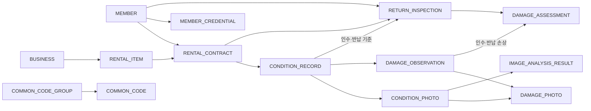

# RentalTrack ERD v2

기준: 사용자 제공 렌탈트랙 (1).damx. SHA-256: `00c3385b8f23190f32b1b0affdd75adde5fff1c98f6e285f423a1b6ce5fb5273`.

[원본 모델](design/rentaltrack-v2.damx) · [문자열 추출 목록](design/schema-observed.json) · [실행용 V11 SQL](../backend/src/main/resources/db/migration/V11__rebuild_rental_inspection_model.sql)

## 원본과 구현 결정

원본에서 엔터티 13개·컬럼 108개·관계 객체 14개를 읽었다. 아래 물리 타입은 원본 문자열이다. NULL 허용·키·관계 수·삭제 정책과 실제 코드값은 완전히 디코딩하지 못했으므로 실행 SQL의 제약을 원본의 확정 제약이라고 표현하지 않는다.

구현에서 결정한 사항:

- MySQL의 테이블·컬럼명은 소문자로 통일. 원본 BIGINT UNSIGNED, DATETIME(3), 비율 DECIMAL(5,4) 사용.
- ID는 AUTO_INCREMENT. 로그인 ID·이메일·사업자등록번호·계약번호는 UNIQUE. 자산관리번호는 사업자 안에서 UNIQUE.
- 상태 기록은 계약·단계·차수, 사진은 기록·순번, 증거는 손상·사진, 분석 후보는 사진·실행·검출순번 조합 UNIQUE.
- 검수는 계약당 한 건, 판정은 검수·반납 손상당 한 건. 기준 기록은 생성 시 선택 후 변경 불가.
- 원본의 inspector_member_id, intake_damage_id, return_damage_id도 각각 회원·손상 관찰 FK로 연결.
- 이력 FK의 삭제·갱신은 RESTRICT. 사진 원본 파일 키는 차수 복사 시 공유하므로 전체 UNIQUE로 제한하지 않음.
- 코드는 원본의 한국어 표시 의미에 맞춰 구현용 토큰을 정의. common_code와 DB CHECK, 서비스 코드 조회를 함께 사용.
- 비밀번호 해시·계정 상태는 인증 확장 테이블 member_credential에 저장. 원본 13개 엔터티의 데이터와 분리.
- 서로 다른 계약·상태 기록의 혼입, 확정 여부·업무 단계는 서비스가 계약 잠금 안에서 검사. FK만으로 보장된다고 표현하지 않음.

## 구현 관계

## 원본 컬럼

### MEMBER

| 컬럼 | 타입 |
| --- | --- |
| member_id | BIGINT UNSIGNED |
| login_id | VARCHAR(50) |
| member_name | VARCHAR(100) |
| email | VARCHAR(254) |
| member_role_cd | VARCHAR(20) |
| created_at | DATETIME(3) |

### BUSINESS

| 컬럼 | 타입 |
| --- | --- |
| business_id | BIGINT UNSIGNED |
| business_no | VARCHAR(10) |
| business_name | VARCHAR(200) |
| business_status_cd | VARCHAR(20) |
| contact_email | VARCHAR(254) |
| created_at | DATETIME(3) |

### RENTAL_ITEM

| 컬럼 | 타입 |
| --- | --- |
| item_id | BIGINT UNSIGNED |
| business_id | BIGINT UNSIGNED |
| asset_code | VARCHAR(40) |
| item_name | VARCHAR(200) |
| category_cd | VARCHAR(30) |
| item_status_cd | VARCHAR(20) |
| description | VARCHAR(1000) |
| created_at | DATETIME(3) |

### RENTAL_CONTRACT

| 컬럼 | 타입 |
| --- | --- |
| contract_id | BIGINT UNSIGNED |
| contract_no | VARCHAR(50) |
| member_id | BIGINT UNSIGNED |
| item_id | BIGINT UNSIGNED |
| requested_at | DATETIME(3) |
| rental_start_at | DATETIME(3) |
| rental_end_at | DATETIME(3) |
| actual_return_at | DATETIME(3) |
| contract_status_cd | VARCHAR(20) |
| created_at | DATETIME(3) |

### CONDITION_RECORD

| 컬럼 | 타입 |
| --- | --- |
| condition_id | BIGINT UNSIGNED |
| contract_id | BIGINT UNSIGNED |
| record_stage_cd | VARCHAR(10) |
| record_revision_no | INT |
| recorded_at | DATETIME(3) |
| record_note | VARCHAR(1000) |
| confirmed_yn | CHAR(1) |
| created_at | DATETIME(3) |

### CONDITION_PHOTO

| 컬럼 | 타입 |
| --- | --- |
| photo_id | BIGINT UNSIGNED |
| condition_id | BIGINT UNSIGNED |
| photo_seq | INT |
| storage_key | VARCHAR(500) |
| original_file_name | VARCHAR(255) |
| mime_type | VARCHAR(100) |
| file_size | BIGINT UNSIGNED |
| file_hash | CHAR(64) |
| capture_angle_cd | VARCHAR(30) |
| captured_at | DATETIME(3) |
| created_at | DATETIME(3) |

### DAMAGE_OBSERVATION

| 컬럼 | 타입 |
| --- | --- |
| damage_id | BIGINT UNSIGNED |
| condition_id | BIGINT UNSIGNED |
| damage_location_cd | VARCHAR(40) |
| damage_type_cd | VARCHAR(40) |
| damage_description | VARCHAR(1000) |
| severity_cd | VARCHAR(20) |
| created_at | DATETIME(3) |

### DAMAGE_PHOTO

| 컬럼 | 타입 |
| --- | --- |
| damage_photo_id | BIGINT UNSIGNED |
| damage_id | BIGINT UNSIGNED |
| photo_id | BIGINT UNSIGNED |
| bbox_x_ratio | DECIMAL(5,4) |
| bbox_y_ratio | DECIMAL(5,4) |
| bbox_width_ratio | DECIMAL(5,4) |
| bbox_height_ratio | DECIMAL(5,4) |
| created_at | DATETIME(3) |

### IMAGE_ANALYSIS_RESULT

| 컬럼 | 타입 |
| --- | --- |
| analysis_result_id | BIGINT UNSIGNED |
| photo_id | BIGINT UNSIGNED |
| analysis_run_id | CHAR(36) |
| detection_seq | INT |
| model_name | VARCHAR(100) |
| model_version | VARCHAR(50) |
| predicted_damage_type_cd | VARCHAR(40) |
| confidence_score | DECIMAL(5,4) |
| bbox_x_ratio | DECIMAL(5,4) |
| bbox_y_ratio | DECIMAL(5,4) |
| bbox_width_ratio | DECIMAL(5,4) |
| bbox_height_ratio | DECIMAL(5,4) |
| analyzed_at | DATETIME(3) |

### RETURN_INSPECTION

| 컬럼 | 타입 |
| --- | --- |
| inspection_id | BIGINT UNSIGNED |
| contract_id | BIGINT UNSIGNED |
| intake_condition_id | BIGINT UNSIGNED |
| return_condition_id | BIGINT UNSIGNED |
| inspector_member_id | BIGINT UNSIGNED |
| inspection_status_cd | VARCHAR(20) |
| overall_result_cd | VARCHAR(20) |
| inspected_at | DATETIME(3) |
| inspection_note | VARCHAR(1000) |
| created_at | DATETIME(3) |

### DAMAGE_ASSESSMENT

| 컬럼 | 타입 |
| --- | --- |
| assessment_id | BIGINT UNSIGNED |
| inspection_id | BIGINT UNSIGNED |
| return_damage_id | BIGINT UNSIGNED |
| intake_damage_id | BIGINT UNSIGNED |
| assessment_result_cd | VARCHAR(20) |
| assessment_reason | VARCHAR(1000) |
| created_at | DATETIME(3) |

### COMMON_CODE_GROUP

| 컬럼 | 타입 |
| --- | --- |
| code_group_id | VARCHAR(40) |
| code_group_name | VARCHAR(100) |
| code_group_description | VARCHAR(500) |
| use_yn | CHAR(1) |
| created_at | DATETIME(3) |
| updated_at | DATETIME(3) |

### COMMON_CODE

| 컬럼 | 타입 |
| --- | --- |
| code_group_id | VARCHAR(40) |
| code_value | VARCHAR(40) |
| code_name | VARCHAR(100) |
| code_description | VARCHAR(500) |
| display_order | INT |
| use_yn | CHAR(1) |
| created_at | DATETIME(3) |
| updated_at | DATETIME(3) |
