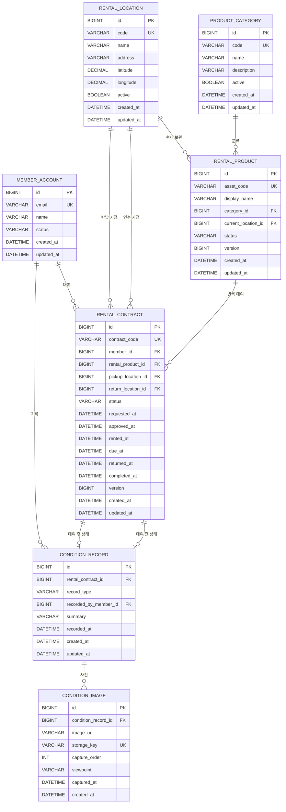

# RentalTrack ERD v1.1

Phase 1의 현재 범위는 `Member / RentalLocation / ProductCategory / RentalProduct / RentalContract / ConditionRecord / ConditionImage`입니다.

## 1. 관계



## 2. Member

`member_account`는 RentalTrack 사용자 계정의 최소 식별 정보만 가집니다.

초기 상태:

```text
ACTIVE
SUSPENDED
WITHDRAWN
```

현재 단계에서는 인증 비밀번호나 OAuth 식별자를 넣지 않습니다. 인증 방식은 Phase 2에서 결정하고, 도메인 핵심 테이블과 인증 자격 증명을 불필요하게 결합하지 않습니다.

## 3. RentalLocation

대여소를 물리 장치나 슬롯으로 모델링하지 않습니다. 웹 서비스에서 상품을 인수·반납할 수 있는 장소만 표현합니다.

- `code`: API와 운영 데이터에서 사용할 안정적인 식별자
- `latitude / longitude`: 주변 지점 탐색과 이후 수요 데이터 연결
- `active`: 운영 종료 지점을 삭제하지 않고 비활성화하여 과거 대여 이력을 보존

## 4. ProductCategory

상품 종류와 개별 상품을 분리합니다.

```text
ProductCategory = POWER_BANK
RentalProduct    = PB-GANGNAM-0001
RentalProduct    = PB-GANGNAM-0002
```

## 5. RentalProduct

같은 종류의 상품이라도 반복 대여 이력을 구분할 수 있도록 개별 자산 단위로 관리합니다.

```text
AVAILABLE
RESERVED
RENTED
INSPECTION
MAINTENANCE
RETIRED
```

`current_location_id`는 현재 상품이 속한 지점입니다. 과거 대여의 위치는 RentalContract가 별도로 보존합니다.

## 6. RentalContract

한 회원이 한 개별 상품을 한 번 대여하는 사건입니다.

```text
REQUESTED
→ APPROVED
→ IN_USE
→ RETURNED
→ INSPECTING
→ COMPLETED
```

예외 상태:

```text
REJECTED
CANCELED
```

`pickup_location_id`와 `return_location_id`를 분리하여 다른 지점 반납도 수용합니다.

## 7. ConditionRecord

상품 상태를 RentalProduct에 덮어쓰지 않고 **대여 건 + 시점**으로 저장합니다.

```text
RentalContract #101
├─ BEFORE_RENTAL
└─ AFTER_RENTAL
```

한 대여 건에는 각 타입의 ConditionRecord를 최대 한 건만 허용합니다.

```text
UNIQUE (rental_contract_id, record_type)
```

이 제약으로 같은 대여 건에서 대여 전 상태 기록이나 반납 후 상태 기록이 중복 생성되는 것을 막습니다.

`recorded_by_member_id`는 nullable입니다. 현재는 회원이 직접 기록하는 흐름을 지원하면서, 이후 운영자 또는 시스템 기록 주체가 추가될 가능성을 열어 둡니다.

## 8. ConditionImage

사진 바이너리를 MySQL에 저장하지 않고 저장소 위치만 관리합니다.

- `image_url`: 웹에서 접근할 이미지 주소
- `storage_key`: Object Storage 내부 식별자
- `capture_order`: 같은 상태 기록 안에서의 촬영 순서
- `viewpoint`: FRONT / BACK / LEFT 등의 촬영 기준을 향후 정형화할 수 있는 값
- `captured_at`: 촬영 시각

같은 ConditionRecord 안에서 `capture_order`는 중복될 수 없습니다.

## 9. 삭제 정책

과거 대여와 상태 이력 보존이 핵심이므로 물리 삭제를 기본 운영 방식으로 사용하지 않습니다.

- Member: `WITHDRAWN`
- Location / Category: `active=false`
- Product: `RETIRED`
- Contract / ConditionRecord / ConditionImage: 이력 보존

FK는 `ON DELETE RESTRICT`를 사용합니다.

## 10. 동시성 기준

`rental_product`와 `rental_contract`에 JPA `@Version`용 `version` 컬럼을 둡니다.

예약 서비스 구현 단계에서 동일 상품에 대한 동시 요청을 optimistic locking으로 제어할 수 있는 기반입니다.

## 11. 다음 ERD 확장

다음 도메인은 이 구조 위에 추가합니다.

```text
DamageRecord
ReturnInspection
```

DamageRecord는 ConditionRecord에 연결하고, ReturnInspection은 RentalContract 단위로 대여 전·후 기록을 비교한 검수 결과를 보존하는 방향으로 설계합니다.
