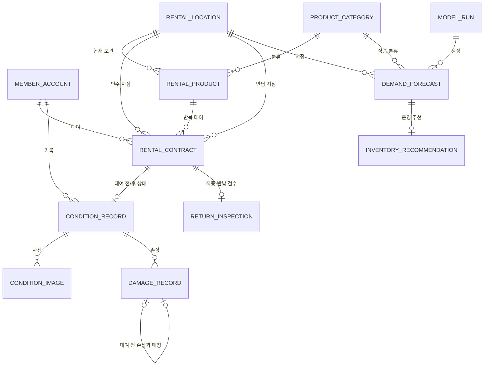

# RentalTrack ERD v1.3

RentalTrack의 핵심 도메인과 운영 데이터는 다음 엔터티로 구성합니다.

`Member / RentalLocation / ProductCategory / RentalProduct / RentalContract / ConditionRecord / ConditionImage / DamageRecord / ReturnInspection / ModelRun / DemandForecast / InventoryRecommendation`

## 1. Core Relationship



## 2. Member

`member_account`는 사용자 인증과 권한에 필요한 최소 계정 정보를 보유합니다.

```text
id
email
password_hash
name
status
role
created_at
updated_at
```

상태:

```text
ACTIVE
SUSPENDED
WITHDRAWN
```

role:

```text
USER
OPERATOR
```

공개 회원가입은 USER만 생성하며 비밀번호는 BCrypt hash로 저장합니다.

## 3. RentalLocation

상품을 인수·반납할 수 있는 대여 지점입니다.

- `code`: 안정적인 외부 식별자
- `latitude / longitude`: 주변 지점 탐색 및 수요 데이터 연결
- `active`: 운영 종료 시 과거 이력을 유지하기 위한 비활성화 플래그

## 4. ProductCategory / RentalProduct

상품 종류와 반복 대여되는 개별 자산을 분리합니다.

```text
ProductCategory = POWER_BANK

RentalProduct = PB-GANGNAM-0001
RentalProduct = PB-GANGNAM-0002
```

RentalProduct 상태:

```text
AVAILABLE
RESERVED
RENTED
INSPECTION
MAINTENANCE
RETIRED
```

동일 상품에 대한 대여 경쟁은 조회 시 `PESSIMISTIC_WRITE` lock으로 직렬화합니다. Entity의 `@Version`은 추가적인 상태 충돌 감지에 사용합니다.

## 5. RentalContract

한 회원이 한 개별 상품을 한 번 대여하는 사건입니다.

```text
REQUESTED
→ APPROVED
→ PICKED_UP
→ IN_USE
→ RETURNED
→ INSPECTING
→ COMPLETED
```

예외 상태:

```text
REJECTED
CANCELED
```

인수 지점과 반납 지점을 분리해 다른 지점 반납과 지점 간 상품 이동 이력을 수용합니다.

## 6. ConditionRecord / ConditionImage

상품 상태를 RentalProduct에 덮어쓰지 않고 대여 건과 시점 기준 snapshot으로 보존합니다.

```text
RentalContract
├─ BEFORE_RENTAL
│  └─ ConditionImage[]
└─ AFTER_RENTAL
   └─ ConditionImage[]
```

한 대여 건에는 각 record type의 ConditionRecord가 최대 한 건만 존재합니다.

```text
UNIQUE (rental_contract_id, record_type)
```

ConditionImage는 파일 자체나 공개 URL을 저장하지 않습니다.

```text
storage_key
original_filename
content_type
file_size
capture_order
viewpoint
captured_at
created_at
```

현재 파일은 Local File adapter가 관리하며 DB에는 저장 위치를 식별하는 storage key와 메타데이터만 보존합니다.

## 7. DamageRecord

DamageRecord는 특정 ConditionRecord에서 확인한 손상을 구조화합니다.

손상 유형:

```text
SCRATCH
DENT
CRACK
BROKEN
STAIN
MISSING_PART
OTHER
```

비교 결과:

```text
BASELINE
UNRESOLVED
EXISTING
NEW
```

대여 후 손상이 기존 손상으로 판정되면 `matched_before_damage_id`로 대여 전 DamageRecord를 직접 참조합니다.

이 비교는 규칙 기반 상태 비교를 돕기 위한 것으로 손상 책임을 AI가 자동 확정하지 않습니다.

## 8. ReturnInspection

RentalContract 하나에 대한 최종 반납 검수 결과입니다.

```text
NO_NEW_DAMAGE
NEW_DAMAGE_CONFIRMED
REVIEW_REQUIRED
```

검수 결과에 따라 상품은 다시 AVAILABLE이 되거나 MAINTENANCE로 전환됩니다.

## 9. Forecast / Recommendation

운영 데이터와 AI 결과를 분리해 추적합니다.

### model_run

모델 실행 단위와 dataset version, run type, MAE/RMSE, 실행 상태를 보존합니다.

### demand_forecast

```text
model_run_id
rental_location_id
product_category_id
forecast_start_at
forecast_end_at
predicted_demand
generated_at
```

지점·상품 분류 단위의 예측 수요를 저장합니다.

### inventory_recommendation

예측 수요와 현재 가용 수량, safety stock을 결합한 운영 추천을 저장합니다.

```text
available_quantity
safety_stock
recommended_additional_quantity
risk_level
status
generated_at
decided_at
```

상태:

```text
OPEN
ACCEPTED
DISMISSED
```

추천 수량은 AI 모델의 직접 출력이 아니라 별도 운영 Rule에서 계산합니다.

## 10. History / Deletion Policy

과거 대여와 상태 이력 보존이 핵심이므로 물리 삭제를 기본 운영 방식으로 사용하지 않습니다.

- Member: `WITHDRAWN`
- Location / Category: `active=false`
- Product: `RETIRED`
- Contract / Condition / Damage / Inspection: 이력 보존

핵심 FK는 과거 기록이 깨지지 않도록 제한적으로 관리합니다.

## 11. Data Flow

```text
Member
→ RentalContract
→ BEFORE_RENTAL ConditionRecord
→ IN_USE
→ AFTER_RENTAL ConditionRecord
→ Damage comparison
→ ReturnInspection
→ COMPLETED

Accumulated rental history
→ hourly demand dataset
→ model_run
→ demand_forecast
→ inventory_recommendation
→ Operator decision
```
