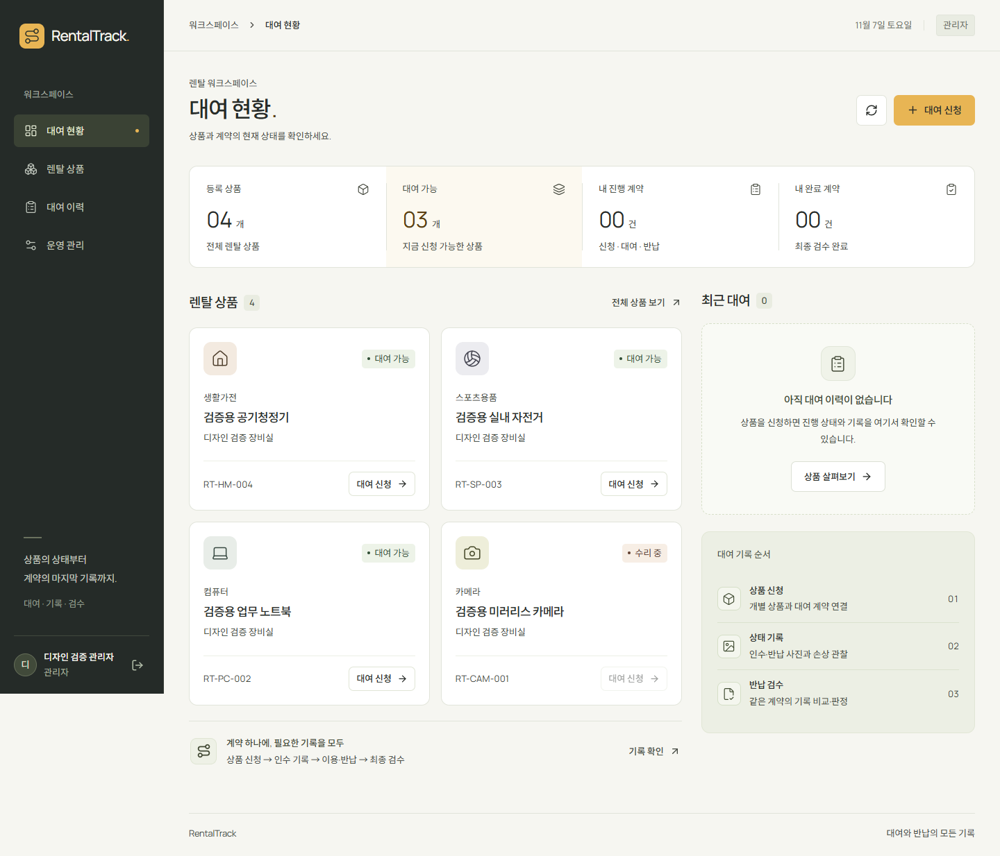
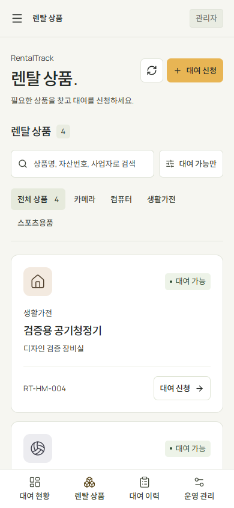

# RentalTrack 워크스페이스 UI

대여·상태 기록·반납 검수를 수행하는 업무용 웹 애플리케이션.

## 디자인 기준

[Leonxlnx/taste-skill](https://github.com/Leonxlnx/taste-skill)의 `design-taste-frontend`(tasteskill 2.5.0)를 참고했다. 검토한 원본은 [9b4bf937](https://github.com/Leonxlnx/taste-skill/tree/9b4bf937a1f69348126959c15d2f99a73e65699b/skills/taste-skill)이다. 스킬은 별도 소스 체크아웃에서 사용했으며 앱 의존성에 포함하지 않았다.

- 차콜 사이드바, 따뜻한 흰색 작업 영역, 앰버 주요 동작 버튼.
- Manrope·Noto Sans KR 가변 글꼴을 로컬 번들로 제공. 라이선스는 `frontend/web/public/licenses/`에 보관.
- Lucide 아이콘, 공통 상태 배지·빈 화면·제목·간격 체계.
- 데스크톱 고정 사이드바, 태블릿 단일 열 비교 화면, 모바일 하단 메뉴와 전체 메뉴 다이얼로그.
- 키보드 포커스, 본문 바로가기, 메뉴 Escape 닫기, hover·press 피드백, reduced-motion 대응.

스킬의 회사 소개 페이지 규칙을 그대로 적용하지는 않았다. 전체 화면 히어로·한 화면에 한 섹션·대형 제목·마케팅 CTA 수 제한 대신, 실제 작업에 필요한 여러 패널과 입력 동작을 유지했다. 사진 아래의 촬영 방향·파일명·해시도 검수 정보이므로 유지한다. 사업자 정보는 업무 입력값 그대로 사용한다. 정해진 팔레트·랜덤 템플릿·셰이더·사진 데모를 앱에 추가하지 않았다.

## 화면 구성

| 화면 | 기능 |
| --- | --- |
| 대여 현황 | 실제 상품 수·대여 가능 수·내 진행/완료 계약, 상품 바로가기, 최근 대여 |
| 렌탈 상품 | 상품명·자산번호·사업자 검색, 분류 필터, 대여 가능 필터, 신청 |
| 대여 이력 | 내 계약 목록, 직원의 계약 ID 조회 |
| 계약 상세 | 진행 단계, 인수·반납 비교, 차수별 기록, 사진·손상 관찰·증거 연결, 검수 판정 |
| 운영 관리 | 관리자 사업자·상품 등록, 기존 이력 매핑·사전 점검·이전 |
| 계정 | 로그인·회원가입 |

검수 전에는 단계별 최신 차수를 비교하고, 검수 생성 후에는 검수에 고정한 인수·반납 기록을 표시한다. 다른 차수는 접어서 열람할 수 있다. 확정 여부에 따른 수정 제한과 새 차수 작성, 권한별 작업은 기존 API를 사용한다.

상품 사진·요금·사양 데이터가 없는 카탈로그에는 분류 아이콘과 실제 등록 필드만 표시한다. 비로그인 상태의 개인 계약 수는 `—`로 표시한다. 검색 결과 없음·상품 없음·대여 이력 없음·사진 로딩/오류 상태를 구분한다.

이미지의 회원·사업자·상품은 화면 검증용 fixture다.

## 검증 (2026-11-07)

- `npx --no-install tsc --noEmit --noUnusedLocals`, `npm run build`.
- Chrome + 임시 MySQL + 실제 API: 고객 로그인 → 상품 검색·필터 초기화 → 신청 → 인수 사진·손상 관찰 → 확정 → 2차 기록 생성·확정 → 이용 시작 → 반납 사진·관찰·확정.
- 관리자 로그인 → 계약 조회 → 인수 2차·반납 1차 고정 → 검수 시작 → 기존/신규 손상 판정 → 완료·신규 손상 있음 확인.
- 기존 이력 이전 패널의 빈 원본 안내·사전 점검·이전 차단 확인. 이번 변경에서 실제 운영 자료를 이전하지 않았다.
- 1440/1024/820/768/390px에서 흐름·가로 넘침·메뉴 Escape·reduced-motion 확인, 브라우저 실행 오류 없음.
- 최종 화면은 320px도 추가 확인. 6개 너비의 상품/현황 화면과 계약 상세 사진 렌더링·가로 넘침·브라우저 오류 확인.

스킬의 `consistency.mjs`는 1440/1024/820/768/390px에서 실행했다. 발견한 텍스트 대비 문제를 수정한 뒤 해당 검사 지적은 0건이었다. 전체 결과는 **155 FAIL / 28 WARN**으로, 전체 검사를 통과한 것은 아니다. 남은 지적은 히어로·섹션 높이/여백·제목 크기·동일 화면 내 섹션/동작 수·정렬선·버튼 종류·비주얼 등 회사 소개 페이지 구성 규칙이다. 업무 앱에서는 패널별 여백, 사이드바와 본문의 서로 다른 경계, 상태별 버튼, 복수 입력 동작을 유지하는 쪽으로 조정했다.

고정 메뉴가 긴 페이지 캡처 중 중간에 나타나는 현상을 피하기 위해 최종 사진은 스크롤을 맨 위로 돌린 뒤 촬영했다. 검증은 이 변경의 UI 흐름에 한정하며, 백엔드 코드와 스키마는 변경하지 않았다.
