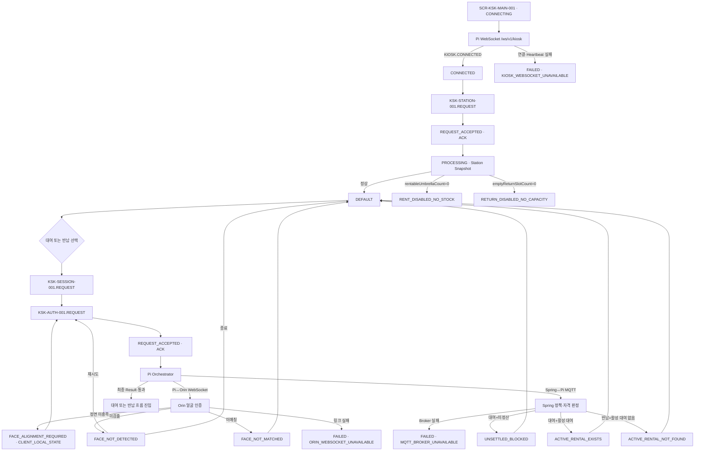
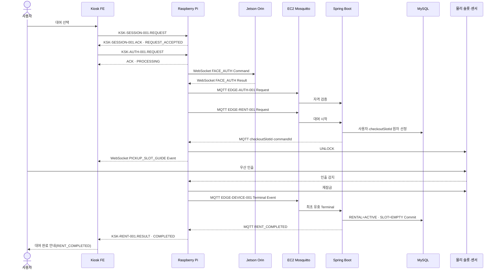
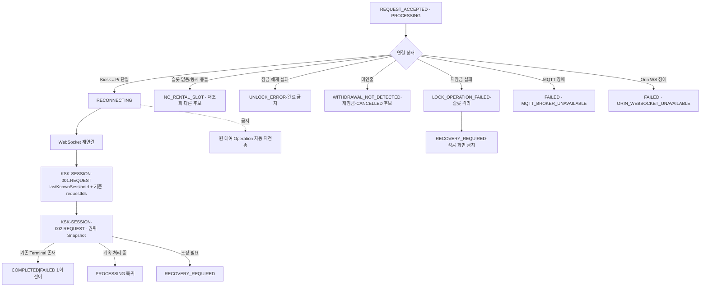
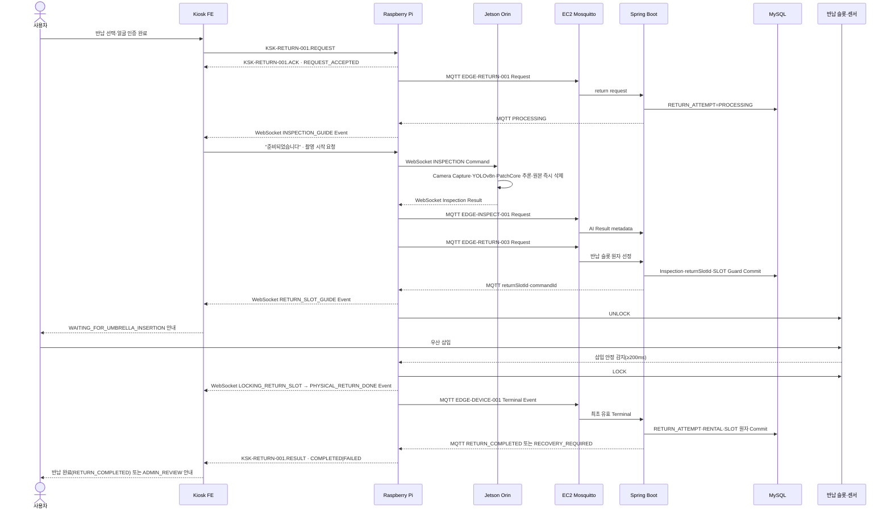
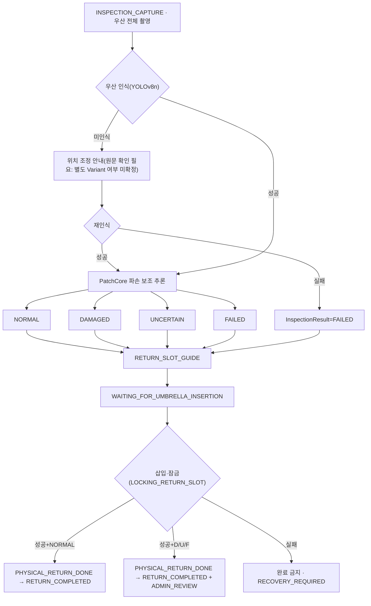
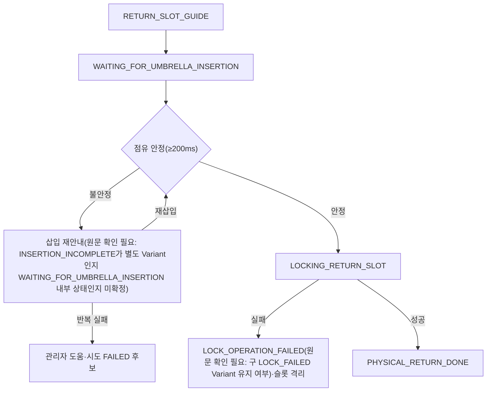
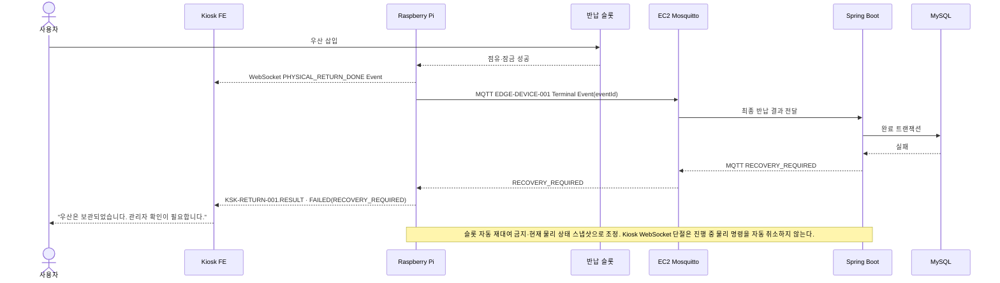
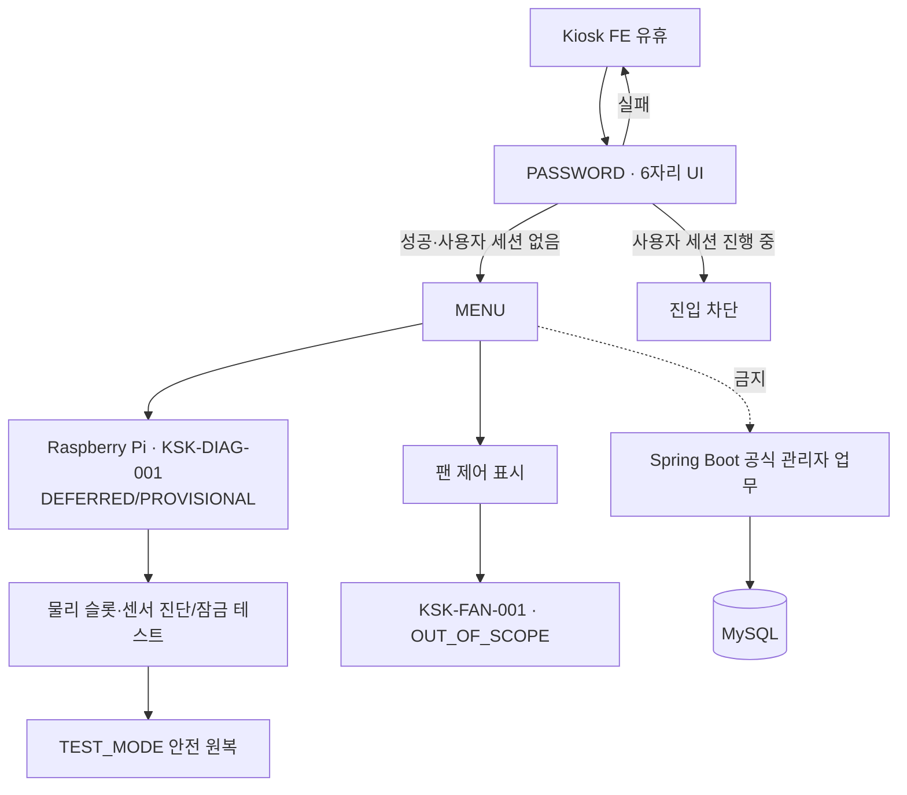

# Billisan Kiosk 화면 흐름 명세 (09번 문서 발췌 · Kiosk 전용)

> 원본: 노션 "09. Billisan Kiosk·App 와이어프레임 기반 화면 흐름 명세 v3.0"
> 이 파일은 원본 중 App(SCR-APP-*)·관리자 Web 관련 부분을 제외하고 Kiosk(SCR-KSK-*) 관련 부분만 발췌함.
> 원본 URL: https://app.notion.com/p/736a5037c20c824ba430014fd569c825
> 문서 상태: `REVIEW_REQUIRED · NOT_RELEASED`, `VERSION_CHANGE_CLASSIFICATION=API_CONTRACT_CHANGE_AND_ARCHITECTURE_CHANGE`, `PREVIOUS_BASELINE=v2.1`, `BREAKING_CHANGE=true`
> **이번 갱신은 v3.0의 `BREAKING_CHANGE` 통신 경계 재정의를 반영한다. 이전 로컬 발췌본(v1.0 기준)은 Kiosk FE→Pi를 "Pi Local API" 성격의 범용 요청/응답으로 서술했으나, v3.0은 이를 Pi WebSocket 7개 논리 Operation으로 확정했다.**
> 09번 원문 자체에 09-R(App·Admin HTTP REST 권위 문서), 12-I(Kiosk↔Pi WebSocket·Spring↔Pi MQTT·Pi↔Orin WebSocket 권위 문서), 12 인덱스(P0 합계) 링크가 명시돼 있으나 이 로컬 발췌본에서는 09번 v3.0 본문 범위만 반영했다. 12-I·12 인덱스 원문 자체는 별도 확인 필요.
> **2026-07-30 추가 갱신**: 12-I 데이터베이스의 Kiosk↔Pi WebSocket 7개 Operation 개별 페이지(`KSK-STATION-001, KSK-SESSION-001, KSK-AUTH-001, KSK-SESSION-002, KSK-RENT-001, KSK-RETURN-001, KSK-CANCEL-001`) 및 상위 공통 문서("12-I. Billisan 장치 메시지·내부 인터페이스 명세서 v3.0 — P0 구현 기준")를 전량 확인해 각 화면 절(3.1~3.6)의 "API 후보" 표 아래에 "메시지 스키마(12-I 확인)" 소절을 추가했다. Heartbeat 간격(10초 Ping/Pong, 30초 무응답 시 단절 판정)과 공통 Envelope(`schemaVersion,messageType,messageId,operationId,sessionId,requestId,correlationId,sentAt,expiresAt,sequence,payload`)는 이번에 확인됐다. **재연결 최대 횟수·지수 Backoff 계수·Jitter 범위는 12-I 공통 문서·개별 Operation 페이지 어디에도 없어 여전히 미확인이다.**

---

## 1. 화면 ID 체계

```
SCR-KSK-MAIN-001
SCR-KSK-AUTH-001
SCR-KSK-RENT-001
SCR-KSK-RETURN-001
SCR-KSK-ERROR-001
SCR-KSK-LOCAL-ADMIN-001
```

- Screen ID 6개는 v1.0과 동일하게 유지된다. 최신 Kiosk 이미지 6장(`Billisan_Kiosk_1.png`~`Billisan_Kiosk_6.png`, Raw Frame 19개)은 이 6개 Screen ID의 Variant로만 관리하며 프레임마다 새 Screen ID를 만들지 않는다.
- 동일 라우트에서 데이터·업무 상태만 달라지는 경우 `/ Variant`로 관리한다.
- 모달은 독립 업무 전이를 발생시키면 Variant로 등록한다.
- Kiosk 기본 Screen ID 6개, 문서화 Variant 25개(원시 프레임 19개·정규화 시각 Variant 18개 + 비가시 필수 상태 7개, App 포함 전체는 App 9개·Variant 37개).

**절대 기준선 (v3.0 §2.5, §3 기준 갱신)**

- MySQL이 업무 SSOT이고 `SLOT`이 재고 단위다.
- 대여는 `checkoutSlotId`, 반납은 `returnSlotId`로 추적한다.
- **[BREAKING] Kiosk FE ↔ Pi는 WebSocket 7개 논리 Operation(`/ws/v1/kiosk`)만 사용한다. Kiosk는 Spring·MQTT·DB·GPIO·Orin에 직접 접근하지 않는다.** (기존 로컬 발췌본의 "Kiosk FE → Pi, Pi → Spring, Pi ↔ Orin 통신 경계를 유지한다"는 방향성은 맞으나, v3.0은 각 구간의 전송 기술을 명시적으로 확정했다: Kiosk↔Pi=WebSocket, Spring↔Pi=MQTT(EC2 Mosquitto 경유, 기존 `EDGE-*` 10개), Pi↔Orin=현장 로컬 WebSocket(Pi가 Endpoint, Orin이 Client).)
- Kiosk→Orin 직접 Preview·제어 경로는 v3.0 활성 호출 경계가 아니다. 영상 표시가 필요하면 별도 미디어 DEC(인증·TLS·Origin·수명·개인정보 경계 확정)가 선행돼야 하며, 그 전까지 `RELEASE_BLOCKING_OPEN_DECISION`이다.
- **Kiosk에는 UUID·userRef·이름·9자리 학번·loginId를 표시하거나 WebSocket Payload로 전달하지 않는다.** 얼굴 인증 처리 중에는 일반 로딩 화면만 표시하며, 학번·이름 등 표시명을 우선 노출하는 아이디어는 v3.0에서 명시적으로 폐기됐다(§6.10 원문: "이미지의 `1549943`과 학번 우선 표시 아이디어는 폐기한다... 얼굴 처리 중에는 일반 로딩 화면만 표시한다"). 이는 기존 로컬 발췌본(v1.0)의 "로딩·환영 문구 | Pi의 최소 결과 | 표시명 최소화"보다 더 엄격한 규정이다 — v1.0은 "최소화"였지만 v3.0은 완전 비표시다.
- **Kiosk는 실제 API 진행률이 아니라 UI 전용 `LOCAL_SIMULATED_CAPPED` 애니메이션을 사용한다.** 약 2~3초를 목표로 0~90%까지만 증가하고, 최종 성공/실패 Result 수신 전에는 100%에 도달하지 않는다. 결과 수신 후에만 100%를 짧게 표시하고 다음 화면으로 이동한다. Timeout·실패 시 100%나 성공 화면을 표시하지 않는다(v3.0 §6.9, §6.12). 진행률 수치는 저장·API 전송·분석 이벤트 수집 대상이 아니다.
- 모든 반납에서 우산 전체 표준 구도 촬영과 AI 보조 검수를 수행한다.
- `DAMAGED|UNCERTAIN|FAILED`여도 가능한 경우 물리 반납을 계속하고 슬롯을 `ADMIN_REVIEW`로 격리한다.
- 대여 완료는 인출·재잠금·DB 저장 성공을 모두 요구한다.
- 물리 반납 완료와 서비스 반납 완료를 분리한다.
- 얼굴·우산 원본 이미지는 영구 저장하지 않는다.
- 제품 3~5 SLOT과 실제 시연 1 SLOT을 분리하며 화면은 응답 배열만 렌더한다(고정 Mock 슬롯 카드 추가 금지).
- Kiosk 실 장비는 터치 입력 가능한 노트북 1대이며, 7인치 고정 Viewport를 기준으로 쓰지 않고 실제 브라우저 Viewport·화면 배율에 반응형으로 렌더링한다(`PENDING_PHYSICAL_UI_TEST · RELEASE_GATE` — 실기 검증 대기 중).

---

## 2. Kiosk 화면 카탈로그 (전체 표)

Kiosk 기본 화면 6개, 문서화 Variant 25개 (App 포함 전체는 기본 9개, Variant 37개 중 Kiosk 분량 6개·25개).

| Screen ID | Variant | 출처 | 화면명 | 진입 조건 | 종료 조건 | Requirement | Story | Policy | 엔터티 | 우선순위 | 판정 |
|---|---|---|---|---|---|---|---|---|---|---|---|
| SCR-KSK-MAIN-001 | DEFAULT | K1-F01 | 대여·반납 선택 | 유휴·Station 정상 | 모드 선택 | FR-RENT-001, FR-RETURN-001 | US-02-001, US-03-001 | POL-ELIGIBILITY-001, POL-RETURN-001 | STATION, SLOT | P0 | ADOPT_LATEST_KIOSK_WIREFRAME |
| SCR-KSK-MAIN-001 | RENT_DISABLED_NO_STOCK | K1-F02 | 대여 비활성 | `rentableUmbrellaCount=0` 또는 `rentAvailable=false` | 재고 복구·갱신 | FR-RENT-004~006 | US-02-003 | POL-ELIGIBILITY-004~005 | STATION, SLOT | P0 | ADOPT_LATEST_KIOSK_WIREFRAME |
| SCR-KSK-MAIN-001 | RETURN_DISABLED_NO_CAPACITY | K1-F03 | 반납 비활성 | `emptyReturnSlotCount=0` 또는 `returnAvailable=false` | 수용량 복구·갱신 | FR-RETURN-001~003 | US-03-001~002 | POL-RETURN-001~002 | STATION, SLOT | P0 | **CORRECT_PREVIOUS_INTERPRETATION** — v1.0의 `RETURN_DISABLED_WIREFRAME_ONLY`(사용자별 활성 대여 여부로 오독, 제거 권장)를 대체. v3.0은 이 Variant가 **Station·Slot 수용량 상태**(빈 반납 슬롯 0)이지 사용자별 자격 상태가 아니라고 명확히 교정했다. 인증 전에는 사용자별 활성 대여·미정산 자격을 판정하지 않는다. |
| SCR-KSK-AUTH-001 | FACE_CAPTURE | K2-F01 | 얼굴 촬영 | 모드 선택 | 검출·정렬 상태 | FR-AUTH-002~003 | US-01-002~003 | POL-AUTH-001,003 | FACE_PROFILE 논리 참조 | P0 | ADOPT_LATEST_KIOSK_WIREFRAME |
| SCR-KSK-AUTH-001 | **FACE_ALIGNMENT_REQUIRED**(신규) | K2-F02 | 정면 정렬 안내 | 얼굴 검출 성공·정면 조건 미충족 | 재안내·촬영 계속 | FR-AUTH-002~003 | US-01-002~003 | POL-AUTH-001,003 | 비영속 로컬 상태 | P0 | CLIENT_LOCAL_STATE — DB 영속 상태·인증 실패 오류가 아니라 로컬 추론·안내 상태. `FACE_NOT_DETECTED`/`FACE_NOT_MATCHED`/`ORIN_UNAVAILABLE`와 혼동 금지 |
| SCR-KSK-AUTH-001 | FACE_PROCESSING | K4-F01 | 얼굴 처리 | 입력 취득·매칭 중 | 정책 검증 | FR-AUTH-003,005~006 | US-01-003 | POL-AUTH-003,005 | USER_ACCOUNT, FACE_PROFILE | P0 | ADOPT_LATEST_KIOSK_WIREFRAME — 로딩만 표시, 학번·이름·`userRef`·사용자 키 표시 금지 |
| SCR-KSK-AUTH-001 | FACE_NOT_DETECTED | K2-F04 | 얼굴 미검출 | 검출 실패 | 재촬영·홈 | FR-AUTH-007 | US-01-004 | POL-AUTH-004 | 없음 | P0 | KEEP_CONFIRMED_BASELINE |
| SCR-KSK-AUTH-001 | FACE_NOT_MATCHED | K2-F05 | 얼굴 미매칭 | 검출 성공·프로필 불일치 | 홈 | FR-AUTH-005~007 | US-01-003~004 | POL-AUTH-003~005 | USER_ACCOUNT, FACE_PROFILE | P0 | KEEP_CONFIRMED_BASELINE |
| SCR-KSK-RENT-001 | PICKUP_SLOT_GUIDE | K4-F03 | 대여 우산함 안내 | 슬롯 선정·잠금 해제 | 센서·재잠금 결과 | FR-RENT-007~010 | US-02-004~006 | POL-RENT-004~007 | RENTAL, SLOT, DEVICE_OPERATION | P0 | ADOPT_LATEST_KIOSK_WIREFRAME |
| SCR-KSK-RENT-001 | RENT_COMPLETED (v1.0 명칭: `COMPLETED`) | K5-F01 | 대여 완료 | 인출·재잠금·MySQL 성공 | 홈 | FR-RENT-011~012 | US-02-005~007 | POL-RENT-006 | RENTAL, SLOT | P0 | ADOPT_LATEST_KIOSK_WIREFRAME |
| SCR-KSK-RETURN-001 | INSPECTION_GUIDE | K1-F04 | 우산 상태 촬영 가이드 | 활성 대여 확인 | 촬영 시작·이전 | FR-RETURN-004~006 | US-03-003~004 | POL-RETURN-003~005 | RETURN_ATTEMPT | P0 | ADOPT_LATEST_KIOSK_WIREFRAME |
| SCR-KSK-RETURN-001 | INSPECTION_CAPTURE (v1.0 명칭: `UMBRELLA_CAPTURE`) | K2-F03 | 우산 촬영 입력 | 촬영 시작 | 추론 시작 | FR-RETURN-004~006 | US-03-003~004 | POL-RETURN-003~005 | DAMAGE_INSPECTION | P0 | ADOPT_LATEST_KIOSK_WIREFRAME |
| SCR-KSK-RETURN-001 | INSPECTION_PROCESSING | K4-F02 | 우산 상태 확인 중 | 임시 입력 취득 | AI 결과 | FR-RETURN-006~007 | US-03-005~007 | POL-INSPECTION-001~003 | DAMAGE_INSPECTION | P0 | ADOPT_LATEST_KIOSK_WIREFRAME |
| SCR-KSK-RETURN-001 | RETURN_SLOT_GUIDE | WIREFRAME_GAP | 반납 슬롯 안내 | AI 결과 기록 | 삽입 대기 | FR-RETURN-008~010 | US-03-006~008 | POL-RETURN-006~007 | RETURN_ATTEMPT, SLOT | P0 | WIREFRAME_GAP — 와이어프레임 시각 자료 없음, 필수 화면 유지 |
| SCR-KSK-RETURN-001 | WAITING_FOR_UMBRELLA_INSERTION(신규 정식화) | WIREFRAME_GAP | 우산 삽입 대기 | 슬롯 잠금 해제 | 삽입 감지 | FR-RETURN-008~010 | US-03-006~008 | POL-RETURN-006~007 | RETURN_ATTEMPT, SLOT | P0 | KEEP_CONFIRMED_BASELINE — v1.0의 `INSERTION_INCOMPLETE`(삽입 불완전 안내) 개념을 이 Variant 내부 상태로 흡수한 것으로 보이나 **원문에 별도 Variant로 명시되지 않아 확인 필요** |
| SCR-KSK-RETURN-001 | LOCKING_RETURN_SLOT(신규 정식화) | WIREFRAME_GAP | 반납 슬롯 재잠금 | 삽입 안정 | 잠금 확인 | FR-LOCK-003 | US-03-008 | POL-RETURN-007 | SLOT, DEVICE_OPERATION | P0 | KEEP_CONFIRMED_BASELINE — v1.0의 `LOCK_FAILED`(잠금 실패 안내)가 이 단계의 실패 분기로 통합됐는지 **원문 확인 필요** |
| SCR-KSK-RETURN-001 | PHYSICAL_RETURN_DONE (v1.0 명칭: `PHYSICAL_DONE`) | WIREFRAME_GAP | 물리 반납 완료·서비스 처리 중 | 삽입·잠금 성공 | Spring 결과 | FR-RETURN-010~012 | US-03-008~009 | POL-RETURN-007~008 | RETURN_ATTEMPT, SLOT | P0 | KEEP_CONFIRMED_BASELINE |
| SCR-KSK-RETURN-001 | RETURN_COMPLETED (v1.0 명칭: `COMPLETED`) | K5-F02 | 반납 완료 | Spring·MySQL 최종 성공 | 홈 | FR-RETURN-008~012 | US-03-005~009 | POL-RETURN-006~008 | RETURN_ATTEMPT, RENTAL, SLOT | P0 | ADOPT_LATEST_KIOSK_WIREFRAME |
| SCR-KSK-RETURN-001 | RECOVERY_REQUIRED | WIREFRAME_GAP | 복구 안내 | 물리 성공·서버 실패/불일치 | 안전 종료·관리자 확인 | FR-RETURN-010~012 | US-SYNC-006 | 복구 정책 | RETURN_ATTEMPT, SLOT | P0 | KEEP_CONFIRMED_BASELINE |
| SCR-KSK-RETURN-001 | ADMIN_REVIEW (v1.0 명칭: `ADMIN_REVIEW_COMPLETED`) | WIREFRAME_GAP | 반납 완료·관리자 검토 예정 | D/U/F + 서비스 완료 | 홈 | FR-INSPECT-001~003 | US-03-005~009 | POL-INSPECTION-001~003 | DAMAGE_INSPECTION, SLOT | P0 | KEEP_CONFIRMED_BASELINE |
| SCR-KSK-ERROR-001 | UNSETTLED_BLOCKED | K3-F01 | 미정산 차단 | 인증 후 미정산 존재 | 닫기·홈 | FR-RENT-002, FR-APP-003 | US-02-002 | POL-ELIGIBILITY-003 | SETTLEMENT | P0 | KEEP_CONFIRMED_BASELINE |
| SCR-KSK-ERROR-001 | ACTIVE_RENTAL_EXISTS | 비가시 필수 | 신규 대여 차단 | 대여 선택 후 활성 대여 존재 | 닫기·홈 | FR-RENT-001 | US-02-001 | POL-USER-003 | RENTAL | P0 | KEEP_CONFIRMED_BASELINE |
| SCR-KSK-ERROR-001 | ACTIVE_RENTAL_NOT_FOUND | K3-F02·F03 | 반납 대상 없음 | 반납 선택 후 활성 대여 없음 | 닫기·홈 | FR-RETURN-001 | US-03-001 | POL-RETURN-001 | RENTAL | P0 | REMOVE_DUPLICATE (구 "대여중인 우산 없음"/"반납할 우산 없음" 두 모달 통합, v1.0과 동일) |
| SCR-KSK-LOCAL-ADMIN-001 | PASSWORD | K6-F01 | 로컬 관리자 인증 | 숨김 진입 | 메뉴·거절 | UNTRACED | UNTRACED | 보안 정책 DEFERRED_NOT_CONTRACTED | 로컬 설정 후보 | DEFERRED_NOT_CONTRACTED | NOT_ACTIVE_P0 |
| SCR-KSK-LOCAL-ADMIN-001 | MENU | K6-F02 | 개별 슬롯 관리·팬 제어 메뉴 | 로컬 관리자 인증 | 진단·홈 | 부분 FR-LOCK-001~006, FR-DRY-001 | 부분 US-07-* | POL-SLOT-* 후보 | SLOT, DEVICE_OPERATION | 혼합 | NOT_ACTIVE_P0 |

**v3.0 판정 코드 참고**: v3.0은 판정 코드 체계를 확장했다(`ADOPT_LATEST_KIOSK_WIREFRAME`, `CORRECT_PREVIOUS_INTERPRETATION`, `KEEP_CONFIRMED_BASELINE`, `CLIENT_LOCAL_STATE`, `WIREFRAME_GAP`, `NOT_ACTIVE_P0` 등). 기존 로컬 발췌본(v1.0)의 `KEEP_BASELINE`/`ADOPT_WIREFRAME_CHANGE`/`DECISION_REQUIRED` 표기와 1:1로 대응하지 않으므로 위 표는 v3.0 원문 판정 코드를 그대로 사용했다.

---

## 3. 화면별 상세 명세

### 3.1 SCR-KSK-MAIN-001 (대여·반납 선택)

**기본 정보**
- 출처: `Billisan_Kiosk_1.png` (K1-F01~F03)
- 목표: 세션 생성 전에 Station 재고·장치 Snapshot을 조회하고 대여·반납 수용 가능 상태를 표시
- 관련 요구사항: FR-RENT-001~006, FR-RETURN-001~003
- 관련 Story: US-02-001~003, US-03-001~002
- 관련 엔터티: STATION, SLOT
- **통신 경계(v3.0)**: Kiosk FE ↔ Pi WebSocket Operation. Pi는 얼굴 인증 후 `EDGE-AUTH-001` MQTT 업무 요청으로 Spring의 사용자별 자격을 검증한다. Kiosk FE는 이 MQTT 왕복을 직접 보지 않는다.

**v3.0 Kiosk WebSocket 연결·요청 상태 (신규 — 모든 Kiosk 화면 공통 적용)**

| 상태 | 의미 | 화면 처리 |
|---|---|---|
| `CONNECTING` | `/ws/v1/kiosk` 연결·인증 진행 | 업무 버튼 비활성, 연결 중 안내 |
| `CONNECTED` | `KIOSK.CONNECTED`와 connectionId 수신 | Station Snapshot 조회 허용 |
| `REQUEST_ACCEPTED` | Operation ACK 수신 | 중복 요청 차단, 성공 화면 금지 |
| `PROCESSING` | Pi·Spring·Orin 또는 물리 장치 처리 중 | 0~90% 로컬 capped animation 또는 Indeterminate |
| `COMPLETED` | 최초 유효 최종 성공 Result/Event 수신 | 성공 화면 1회 전이, 그 뒤만 100% 허용 |
| `FAILED` | 최초 유효 최종 실패 Result/Event 수신 | 원인별 오류 UX, 자동 재전송 금지 |
| `RECONNECTING` | Heartbeat 단절 또는 연결 종료 후 복구 중 | 업무 버튼 비활성, 상태 조정 전 성공·실패 추정 금지 |

- 정상 전이: `CONNECTING → CONNECTED → REQUEST_ACCEPTED → PROCESSING → COMPLETED|FAILED`.
- 연결 단절 시 `RECONNECTING`으로 전이하고 자동으로 원 Operation을 재전송하지 않는다.
- 재연결 후 `KSK-SESSION-001`에 `lastKnownSessionId`와 기존 `requestId|operationRequestIds`를 보내 세션을 복구하고, `KSK-SESSION-002`로 Pi 권위 Snapshot을 조회한다.
- 동일 `requestId|correlationId`의 ACK·Result/Event 재수신은 화면 전이·대여·반납을 중복 실행하지 않고 기존 결과를 재사용한다.
- 화면 이탈이나 WebSocket 종료만으로 이미 시작된 물리 Command를 자동 취소하지 않는다. 취소는 `KSK-CANCEL-001` 계약을 따른다.

**연결·Heartbeat·Envelope 공통 규칙 (12-I 확인, 2026-07-30)**
- 서버: Raspberry Pi WebSocket Server. 클라이언트: Kiosk FE WebSocket Client. 연결 수립 후 Kiosk가 `KIOSK.CONNECT`를 보내면 Pi가 `KIOSK.CONNECTED`와 `connectionId(UUID)`로 응답한다.
- **Heartbeat는 WebSocket Ping/Pong을 10초 간격으로 사용한다. 30초 동안 유효 Pong이 없으면 해당 연결만 `KIOSK_WEBSOCKET_UNAVAILABLE`로 판정하고 재연결한다.** (12-I 공통 문서 K-0절에서 확인, 이전까지 "미확인"이었던 수치)
- 동일 Kiosk 인스턴스의 중복 연결은 새 `connectionId`가 기존 연결을 승계하며 이전 연결의 메시지는 거절한다.
- **재연결 최대 시도 횟수, 지수 Backoff 계수, Jitter 범위는 12-I 공통 문서·7개 Operation 개별 페이지 어디에도 명시되어 있지 않다 — 여전히 미확인이며 임의로 수치를 정하지 않는다.**
- 공통 Message Envelope(모든 Request/ACK/Event/Result/Error 공통): `schemaVersion(String,"1.0"), messageType(String), messageId(UUID), operationId(Enum, KSK-* 7개 중 하나), sessionId(UUID|null, Station 조회·세션 생성 Request만 null), requestId(UUID, 도메인 멱등 키), correlationId(UUID, 전송 시도별 ID), sentAt(DateTime), expiresAt(DateTime), sequence(Long, 연결·방향별 단조 증가), payload(Object)`.
- 공통 ACK Payload: `ackStatus(ACCEPTED|DUPLICATE|REJECTED), acceptedAt, errorCode|null`. 모든 Operation의 ACK Timeout은 2초로 통일돼 있다.
- 공통 Terminal 규칙: 최종 Result는 `terminalStatus(SUCCEEDED|FAILED|CANCELLED|RECOVERY_REQUIRED)`를 포함하며, 진행 안내는 Event이지 Terminal이 아니다.
- 공통 Error: 7개 Operation 모두 `messageType=KIOSK.OPERATION.ERROR`를 공유하며 Payload는 `code, messageCode, retryable, details|null`이다(원문 예외·Stack Trace 미포함).
- 재연결·ACK 유실 재전송은 **같은 `(sessionId, operationId, requestId)`에 새 `correlationId`만 바꿔 사용**한다. Pi는 이 3개 키로 중복을 제거하고 기존 상태·Terminal을 반환한다.

**KSK-CANCEL-001 메시지 스키마 (전체 화면 공통 취소 Operation, 12-I 확인)**
- messageType: Request `KIOSK.SESSION.CANCEL.REQUEST` / ACK `KIOSK.SESSION.CANCEL.ACK` / Event 없음 / Result `KIOSK.SESSION.CANCEL.RESULT` / Error `KIOSK.OPERATION.ERROR`.
- Request Payload: `reasonCode(USER_CANCELLED|SCREEN_EXIT|OPERATOR_CANCELLED)`. Envelope `sessionId`=취소 대상 세션.
- Result Payload: `sessionId, terminalStatus=CANCELLED, status=CANCELLED, cancelledAt`.
- Error Code: `SESSION_NOT_FOUND|SESSION_ALREADY_TERMINAL|CANCEL_NOT_ALLOWED|PHYSICAL_OPERATION_IN_PROGRESS|CAMERA_CAPTURE_IN_PROGRESS|COMMAND_EXPIRED`.
- 취소 허용 경계: 얼굴 Camera Capture Lease·Spring 물리 Command Publish·우산 삽입/잠금/검수가 시작되기 전까지만 허용. 그 이후는 `CANCEL_NOT_ALLOWED`이며 기존 작업을 중단하지 않고 `KSK-SESSION-002`로 Terminal/조정 결과를 복구 조회한다.
- Timeout: ACK 2초, Result 3초. ACK/Result 유실 시 같은 `requestId`+새 `correlationId`로 재전송, 이미 취소된 세션은 기존 `cancelledAt`을 반환.
- 참고: 이 Operation은 09-screen-flow.md의 기존 3.1~3.6 "API 후보" 표 어디에도 나열되지 않았던 항목이다(PROJECT_GUIDE.md §5.4에는 있었음) — 이번 확인으로 3.1절에 추가 반영.

**Station Summary 계약**
- `KSK-STATION-001`은 Spring `EDGE-SNAPSHOT-001/EDGE-HEALTH-001`에서 온 summary만 표시한다. TTL 5초, stale이면 재조회, Spring 불가 시 `STATION_SUMMARY_UNAVAILABLE` 오류 화면.
- Pi sensor/로컬 cache로 공식 대여 가능·빈 반납 SLOT 수를 추정하지 않는다. Broker/TLS/WAN 불가면 두 진입 버튼을 비활성화하고 `MQTT_BROKER_UNAVAILABLE`를 안내한다.
- 1슬롯 시연에서는 서버가 준 한 SLOT의 파생 가능 여부만 표시하며 슬롯 선택 UI를 제공하지 않는다.

**Variant**
| Variant | 판정 조건 | 화면 처리 |
|---|---|---|
| DEFAULT | `rentAvailable=true, returnAvailable=true`, Snapshot 정상 | 대여·반납 활성 |
| RENT_DISABLED_NO_STOCK | `rentableUmbrellaCount=0` 또는 `rentAvailable=false` | 대여 비활성 · "우산 재고 없음" |
| RETURN_DISABLED_NO_CAPACITY | `emptyReturnSlotCount=0` 또는 `returnAvailable=false` 또는 안전 수용 불가 | 반납 비활성 · "우산함 여유 없음" |

- `RETURN_DISABLED_NO_CAPACITY`는 사용자별 활성 대여 상태가 아니라 Station·Slot 수용량 상태다(v1.0 대비 해석 교정, WF-CHANGE-009).
- 인증 전에는 미정산·활성 대여 등 사용자별 업무 자격을 판정하지 않는다.

**화면 데이터**
| 데이터 | 출처·분류 | 규칙 |
|---|---|---|
| 현재 시각 | CLIENT_LOCAL_STATE | 단말 로컬 표시값 |
| 운영 시간 | STATIC_CONTENT 또는 SPRING_KIOSK_QUERY · PROVISIONAL | 데이터 출처 `DEC-SF-016` 미확정 |
| 대여 가능 우산 수·빈 반납 슬롯 수 | `KSK-STATION-001` | observedAt·stale 동시 표시 판단 |
| 대여·반납 가능 여부 | `KSK-STATION-001` | blockingReasons와 일치 |
| 사용자별 자격 | 얼굴 인증 후 Spring(Pi 경유) | 메인 Snapshot으로 추정 금지 |

**상태·복구**
- Spring 연결 전·Edge Snapshot stale·장치 불명은 정상 재고로 확정하지 않는다.
- 재고만 불명확할 때도 안전한 반납 수용 가능성을 별도 판단한다.
- 세션 종료·만료 시 사용자 표시 정보를 삭제한다.

**API 후보 (v3.0 — 확정 Operation ID로 교체)**
| Operation ID | 목적 | 성격 | 확정도 |
|---|---|---|---|
| `KSK-STATION-001` | 세션 전 Station 재고·수용량 Snapshot 조회 | Query | `CONFIRMED_API` |
| `KSK-SESSION-001` | 일회성 세션 생성·종료(재연결 복구 포함) | Command | `CONFIRMED_API` |

이전 로컬 발췌본의 `CAND-KSK-LOCAL-SESSION-001`/`CAND-KSK-LOCAL-AVAILABILITY-001` placeholder는 위 두 확정 Operation ID로 교체됐다.

**메시지 스키마(12-I 확인, 2026-07-30)**

`KSK-STATION-001`
| 항목 | 값 |
|---|---|
| Request | `KIOSK.STATION_SUMMARY.REQUEST` |
| ACK | `KIOSK.STATION_SUMMARY.ACK` |
| Event | 없음 |
| Result | `KIOSK.STATION_SUMMARY.RESULT` |
| Error | `KIOSK.OPERATION.ERROR` |

- Request Payload: `stationId(UUID)`. Envelope `sessionId=null`(세션 전 조회).
- Result Payload: `stationId, observedAt, stale, operating{status:OPEN|CLOSED|UNAVAILABLE}, inventory{rentableSlotCount, emptyReturnSlotCount}, availability{rentAvailable, returnAvailable, blockingReasons}`.
- Error Code: `STATION_SUMMARY_UNAVAILABLE|STATION_MISMATCH|DEVICE_OFFLINE|SNAPSHOT_STALE|COMMAND_EXPIRED`.
- Timeout: ACK 2초, Result 3초. Snapshot TTL 5초 초과 시 `stale=true`(또는 `SNAPSHOT_STALE`).
- 멱등성: 조회 Operation이므로 동일 `(sessionId,operationId,requestId)` 재전송은 상태 변경 없이 같은 권위 Snapshot을 반환한다.

`KSK-SESSION-001`
| 항목 | 값 |
|---|---|
| Request | `KIOSK.SESSION.OPEN.REQUEST` |
| ACK | `KIOSK.SESSION.OPEN.ACK` |
| Event | `KIOSK.SESSION.OPEN.EVENT` |
| Result | `KIOSK.SESSION.OPEN.RESULT` |
| Error | `KIOSK.OPERATION.ERROR` |

- Request Payload: `mode(RENT|RETURN), stationId(UUID), clientSessionKey(String), lastKnownSessionId(UUID|null), operationRequestIds{faceAuthRequestId,rentalRequestId,returnRequestId}(각 UUID|null)`.
- Event Payload(복구 중): `status=RECOVERING, sessionId|null, recoveryStep`.
- Result Payload: `sessionId(UUID), mode, status(ACTIVE|RECOVERING|COMPLETED|FAILED|CANCELLED|RECOVERY_REQUIRED), expiresAt`.
- Error Code: `SESSION_CONFLICT|STATION_MISMATCH|SESSION_RECOVERY_REQUIRED|COMMAND_EXPIRED|KIOSK_WEBSOCKET_UNAVAILABLE`.
- Timeout: ACK 2초, Result 3초.
- 멱등성: 같은 `clientSessionKey,mode,stationId`로 활성 세션이 있으면 새 세션을 만들지 않고 기존 `sessionId`를 반환한다. Envelope `requestId`는 이번 Open/Recover 호출 ID이고, Result의 `sessionId`가 이후 6개 Operation(`KSK-AUTH-001` 등)이 공유하는 안정 세션 ID다.

---

### 3.2 SCR-KSK-AUTH-001 (얼굴 인증)

**세션·개인정보·Camera (v3.0 신규 규정)**
- 시작 시 Web Crypto `clientSessionKey`를 sessionStorage에 생성하고 `lastKnownSessionId, operationRequestIds`와 함께 Pi WebSocket `/ws/v1/kiosk` 연결만 사용한다.
- **Kiosk→Orin 직접 Preview·제어는 활성 경계가 아니다.** 별도 미디어 DEC 전에는 Pi WebSocket이 전달하는 안내·상태만 표시한다.
- Kiosk↔Pi 연결 오류는 `KIOSK_WEBSOCKET_UNAVAILABLE`, Spring↔Pi 오류는 `MQTT_BROKER_UNAVAILABLE`, Pi↔Orin 오류는 `ORIN_WEBSOCKET_UNAVAILABLE`로 분리한다 — 셋은 서로 독립이며 한 연결의 장애를 다른 연결 전체 장애로 확장하지 않는다.
- **얼굴 안내·로딩·익명 결과만 표시하고 UUID·userRef·이름·학번·loginId·이미지 캡처/다운로드가 없다.**
- 새로고침은 같은 Pi process의 active session을 조회한다. Pi reboot 후 request IDs로 기존 결과만 확인하고 명령을 replay하지 않는다. `RECOVERING|RECOVERY_REQUIRED`는 성공 화면이 아니다.

**기본 정보**
- 출처: `Billisan_Kiosk_2.png`(K2-F01·F02·F04·F05), `Billisan_Kiosk_4.png`(K4-F01)
- 목표: Pi WebSocket이 전달하는 얼굴 인식 안내와 업무 상태·정책 결과만 표시. Pi는 내부적으로 Orin과 WebSocket으로 얼굴 Command/Result를 교환하고 Spring과 MQTT로 공식 정책·상태를 교환하지만, Kiosk는 Orin·Spring에 직접 접근하지 않는다.
- 저장 정책: Kiosk는 Orin에 직접 연결하지 않으며 Pi WebSocket이 전달한 상태만 표시한다. 인증 원본·임베딩·유사도 원시값은 Kiosk FE·Spring·MySQL·일반 로그에 저장하거나 반환하지 않는다.

**Variant**
| Variant | 조건 | 표시·행동 | 다음 단계 |
|---|---|---|---|
| FACE_CAPTURE | 카메라 준비 | 얼굴 가이드·프리뷰 | 정렬 안내 또는 처리 |
| **FACE_ALIGNMENT_REQUIRED**(신규) | 얼굴 검출 성공·정면 입력 조건 미충족 | "정면을 바라봐 주세요" · 세션 유지·즉시 재안내 | FACE_CAPTURE |
| FACE_PROCESSING | 입력 취득·UUID 매칭 중 | **로딩 중 화면만 표시. 학번·이름·`userRef`·사용자 키를 표시하지 않음** | Spring 사용자 행·역할·업무 자격 검증 |
| FACE_NOT_DETECTED | 얼굴 미검출 | 재시도·홈 | 새 촬영 또는 종료 |
| FACE_NOT_MATCHED | 검출 성공·프로필 불일치 | 일치 정보 없음·홈 | 잠금 명령 없이 종료 |

- `FACE_ALIGNMENT_REQUIRED`는 DB 영속 상태나 인증 실패 HTTP/WS 오류가 아니라 **로컬 추론·화면 안내 상태**(`CLIENT_LOCAL_STATE`)다. `FACE_NOT_DETECTED`, `FACE_NOT_MATCHED`, `ORIN_UNAVAILABLE`, `POLICY_REJECTED`와 혼합하지 않는다.
- 학번·이름 우선 표시 아이디어는 v3.0에서 폐기됐다. Orin은 Pi와의 내부 WebSocket에서 비식별 상관 키만 사용하며, Kiosk WebSocket Payload에는 9자리 학번·loginId·이름·UUID·userRef를 포함하지 않는다.

**사용자 액션·복구**
- 재시도는 새 `authRequestId`를 사용하고, 취소·타임아웃 시 입력과 표시 정보를 즉시 폐기한다.
- 재시도 횟수·인증 유효 시간·세션 만료는 `NOT_ACTIVE_P0`다(`DEC-SF-010` 참고, 6절).

**API 후보 (v3.0 확정)**
| Operation ID | 목적 | 성격 | 확정도 |
|---|---|---|---|
| `KSK-AUTH-001` | 얼굴 인증 시작 | Command | `CONFIRMED_API` |
| `KSK-SESSION-002` | 얼굴 안내·대여·반납 진행 상태 조회 | Query | `CONFIRMED_API` |

Pi 내부 참고(Kiosk가 직접 호출하지 않음): `EDGE-AUTH-001`(Pi→Spring MQTT, 얼굴 인증 결과의 사용자·정책 검증).

이전 로컬 발췌본의 `CAND-KSK-LOCAL-AUTH-001`, `CAND-PI-ORIN-FACE-001`, `CAND-PI-SPRING-ELIGIBILITY-001` placeholder는 위 확정 Operation ID(`KSK-AUTH-001`, `KSK-SESSION-002`)와 Pi 내부 MQTT 계약(`EDGE-AUTH-001`)으로 정리됐다.

**메시지 스키마(12-I 확인, 2026-07-30)**

`KSK-AUTH-001`
| 항목 | 값 |
|---|---|
| Request | `KIOSK.FACE_AUTH.REQUEST` |
| ACK | `KIOSK.FACE_AUTH.ACK` |
| Event | `KIOSK.FACE_AUTH.EVENT` |
| Result | `KIOSK.FACE_AUTH.RESULT` |
| Error | `KIOSK.OPERATION.ERROR` |

- Request Payload: `authRequestId(UUID)` — 얼굴 인증 도메인 멱등 키이며 Envelope `requestId`와 동일. Envelope `sessionId`는 `ACTIVE` 상태의 RENT/RETURN 세션.
- Event Payload: `sessionId, authRequestId, status(GUIDANCE|AUTH_PROCESSING), guidanceCode, progressMode=INDETERMINATE`. ACK·Event 모두 Camera·AI·Spring 자격 검증 성공을 의미하지 않는다.
- Result Payload: `sessionId, authRequestId, authenticated, eligibility, kioskStep, userMessageCode, retryable`. **이름·학번·loginId·userRef·이미지·Embedding은 포함하지 않는다**(v3.0 개인정보 규정과 일치, 12-I 원문에서도 재확인).
- Error Code: `FACE_NOT_DETECTED|MULTIPLE_FACES|AUTHENTICATION_FAILED|ORIN_WEBSOCKET_UNAVAILABLE|ORIN_RESULT_TIMEOUT|MQTT_BROKER_UNAVAILABLE|USER_NOT_ELIGIBLE|COMMAND_EXPIRED`.
- Timeout: ACK 2초, **얼굴 인증 Terminal Timeout 15초**(DEC-SF-010과 관련된 수치이나, DEC-SF-010 자체가 다루는 "재시도 횟수·세션 유효시간"과는 별개 항목 — 재시도 횟수는 여전히 미확인).
- 멱등성: ACK 유실은 같은 `authRequestId`+새 `correlationId`로 재전송(Pi·Orin은 기존 진행·Terminal 반환, 중복 Capture·추론 없음). Terminal Timeout 뒤 자동 재촬영 없음 — `KSK-SESSION-002`로 상태 조회 후 사용자 명시 재시도만 새 `authRequestId` 발급.
- 취소: Camera Capture 시작 전까지만 명시적 취소 허용, 이후는 Terminal/복구 결과를 따름.

`KSK-SESSION-002` (얼굴 인증·대여·반납 진행 상태 조회 공통 Operation — 3.2·3.3·3.4에서 공유)
| 항목 | 값 |
|---|---|
| Request | `KIOSK.SESSION.STATE.REQUEST` |
| ACK | `KIOSK.SESSION.STATE.ACK` |
| Event | 없음 |
| Result | `KIOSK.SESSION.STATE.RESULT` |
| Error | `KIOSK.OPERATION.ERROR` |

- Request Payload: 업무 Body 없음. Envelope `sessionId,requestId,correlationId,expiresAt` 사용. 선택 필드 `lastSeenSequence(Long|null)`은 Event 유실 확인용.
- Result Payload(전체 필드, 화면별로 관련 필드만 사용): `sessionId, mode, status, kioskStep, faceGuidance, eligibility, checkoutSlot, returnSlot, rentalId, returnAttemptId, returnAttemptStatus, inspectionResult, progressMode, rentalSummary, failureCode, userActionCode, userMessageCode, retryable, expiresAt`.
  - AUTH 화면 관련 필드: `kioskStep(FACE_GUIDE|AUTH_PROCESSING|...)`, `faceGuidance`, `eligibility`.
  - `progressMode=INDETERMINATE`이며 실측값이 없으면 `progressPercent` 자체를 반환하지 않는다(09번 §1의 `LOCAL_SIMULATED_CAPPED`는 Kiosk UI 전용 값이며 이 필드와 별개).
  - `RENTAL.status=FAILED` 확정 시에만 `failureCode`·`userActionCode`가 채워지고, 그 외 상태에서는 `failureCode=null`. `failure_message`·Stack Trace·MQTT 전체 Payload는 포함하지 않는다.
- Error Code: `SESSION_NOT_FOUND|SESSION_EXPIRED|SESSION_RECOVERY_REQUIRED|COMMAND_EXPIRED`.
- Timeout: ACK 2초, Result 3초.
- 멱등성: 조회 Operation이므로 같은 `requestId` 재전송은 상태 변경 없이 최신 권위 상태를 반환한다.
- **미확인 항목**: `ACTIVE_RENTAL_EXISTS`/`ACTIVE_RENTAL_NOT_FOUND`/`UNSETTLED_EXISTS`(17장 오류 코드표에 있는 값)가 이 Result의 `eligibility.blockingReasons` 배열 값인지, 아니면 다른 필드·별도 Error Code인지는 12-I 개별 Operation 페이지 어디에도 명시적으로 나오지 않는다 — 추측하지 않고 미확인으로 유지.

---

### 3.3 SCR-KSK-RENT-001 (정상 대여·대여 결과)

**완료·시간 표시 기준**
- Spring이 지정한 `slotNumber`만 안내하고 사용자가 slot을 선택하거나 "꺼냈어요" 버튼으로 완료시키지 않는다.
- unlock 성공, 인출 센서 감지(≥200ms), `DEVICE_OPERATION SUCCEEDED`, Spring `RENTAL+SLOT` commit 응답 뒤에만 완료를 표시한다. 30초 미제거·unlock/sensor/DB 실패와 `MQTT_BROKER_UNAVAILABLE`를 성공으로 표시하지 않고 가능하면 relock·관리자 확인으로 전환한다. 대여에 Orin 추론이 필요한 단계가 있다면 `ORIN_WEBSOCKET_UNAVAILABLE`도 별도 원인으로 표시한다.
- 완료 카드의 `rentedAt, dueAt`은 서버 값을 그대로 표시한다. 무료 24시간·연체 일수/금액을 클라이언트가 재계산해 권위값으로 만들지 않는다.
- 결과를 기다리는 local animation이 있더라도 0~90% cap이며 terminal success 뒤만 100%다.

**Variant**
| Variant | 진입 조건 | 표시 데이터 | 종료 조건 |
|---|---|---|---|
| PICKUP_SLOT_GUIDE | 자격·`checkoutSlotId` 선정·잠금 해제 성공 | `checkoutSlotId, slotNumber`, "꺼냈어요" | 센서·재잠금·Spring 결과 |
| RENT_COMPLETED (v1.0 명칭: `COMPLETED`) | 인출 감지 + 재잠금 확인 + Spring/MySQL 저장 성공 | `rentalSummary.rentedAt, rentalSummary.dueAt`, "홈으로" | 홈·세션 초기화 |

**사용자 액션·장치 이벤트**
- "꺼냈어요"는 `USER_CONFIRMED_PICKUP_GUIDE`라는 **로컬 사용자 확인 신호일 뿐 장치 완료 API가 아니다.**
- 클릭만으로 `RENT_COMPLETED`로 전환하거나 Spring에 완료 이벤트를 보내지 않는다.
- 우산 인출 감지 → 슬롯 재잠금 확인 → Spring/MySQL 대여 저장 성공이 모두 확인되어야 한다.

**Mock·데이터 규칙**
- 슬롯 번호, 대학 계정 표시값, 대여 날짜·시각, 반납 기한은 Mock fixture다. 대학 계정·학번 표시값은 Kiosk 화면에서 제거하고 `USER_ACCOUNT.student_number` 도입 근거로 사용하지 않는다.
- Kiosk FE가 대여 시각·반납 기한을 자체 계산하지 않으며 Pi WebSocket Result가 전달한 Spring 계산값을 그대로 표시한다.

**상태·복구**
| 상태 | 안내 | 완료 허용 |
|---|---|---|
| NOT_WITHDRAWN | 인출 재안내·재잠금 | 금지 |
| LOCK_ERROR | 슬롯 격리·관리자 확인 | 금지 |
| PHYSICAL_WITHDRAWN_DB_FAILED | RECOVERY_REQUIRED | 금지 |
| RENT_COMPLETED | 대여 완료 | 인출·잠금·DB 모두 성공 |

**API 후보 (v3.0 확정)**
| Operation ID | 목적 | 성격 | 확정도 |
|---|---|---|---|
| `KSK-RENT-001` | 대여 시작 | Command | `CONFIRMED_API` |
| `KSK-SESSION-002` | 대여 진행 상태 조회 | Query | `CONFIRMED_API` |

Pi 내부 참고: `EDGE-RENT-001`(자격·슬롯 원자 선정·시작), `EDGE-RENT-002`(대여 물리 결과·완료/복구), `EDGE-DEVICE-001`(물리 Command Terminal Event 반영) — 모두 Pi↔Spring MQTT이며 Kiosk가 직접 호출하지 않는다.

이전 로컬 발췌본의 `CAND-KSK-LOCAL-RENT-001`, `CAND-KSK-LOCAL-RENT-STATUS-001`, `CAND-PI-SPRING-RENT-001`, `CAND-PI-SPRING-RENT-RESULT-001`은 `KSK-RENT-001`/`KSK-SESSION-002`(Kiosk 측)와 `EDGE-RENT-001`/`EDGE-RENT-002`/`EDGE-DEVICE-001`(Pi 내부 MQTT)로 교체됐다.

**메시지 스키마(12-I 확인, 2026-07-30)**

`KSK-RENT-001`
| 항목 | 값 |
|---|---|
| Request | `KIOSK.RENT.REQUEST` |
| ACK | `KIOSK.RENT.ACK` |
| Event | `KIOSK.RENT.EVENT` |
| Result | `KIOSK.RENT.RESULT` |
| Error | `KIOSK.OPERATION.ERROR` |

- Request Payload: `rentalRequestId(UUID)` — 대여 도메인 멱등 키이며 Envelope `requestId`와 동일. Envelope `sessionId`는 인증·자격 검증이 끝난 RENT 세션. Kiosk는 SLOT을 지정하지 않는다.
- Event Payload: `sessionId, rentalRequestId, status, kioskStep, checkoutSlotId, slotNumber, userMessageCode`. `status=RENT_SLOT_READY|DEVICE_COMMAND_ACCEPTED|WAITING_PHYSICAL_REMOVAL`은 진행 상태이며 Terminal이 아니다.
- Result Payload: `sessionId, rentalRequestId, terminalStatus, status, rentalId, checkoutSlotId, slotNumber, rentalSummary`. `rentalSummary={rentalId, rentedAt, dueAt}`는 Spring이 대여를 최종 Commit한 성공 Result에만 존재(그 외에는 없음/`null`).
- Error Code: `USER_NOT_ELIGIBLE|SLOT_NOT_AVAILABLE|SLOT_CONFLICT|MQTT_BROKER_UNAVAILABLE|DEVICE_OFFLINE|DEVICE_COMMAND_TIMEOUT|UNLOCK_FAILED|PHYSICAL_REMOVAL_NOT_DETECTED|STATE_RECONCILIATION_REQUIRED|COMMAND_EXPIRED`.
- Timeout: ACK 2초, **물리 제거(인출) 제한 30초**, **최종 Result 대기 한도 35초**.
- 멱등성: ACK/Event/Result 유실은 같은 `rentalRequestId`+새 `correlationId`로 재전송. Spring `RENTAL.rental_request_id`와 장치 `commandId`가 중복 실행을 막는다. Timeout 뒤 새 대여 Request를 자동 생성하지 않고 `KSK-SESSION-002`+Spring MQTT 복구 조회로 확인한다.
- 화면 전이: `RENT_READY → RENT_PROCESSING → REMOVE_UMBRELLA → RENT_COMPLETED`(실패·Timeout은 `FAILED|RECOVERY_REQUIRED`). 취소는 Spring 물리 Command Publish 전까지만 허용.

`KSK-SESSION-002` 상세 스키마는 3.2절 참고. 대여 화면에서 주로 쓰는 필드: `kioskStep(RENT_PROCESSING|REMOVE_UMBRELLA|...)`, `checkoutSlot{slotId,slotNumber}`, `rentalId`, `rentalSummary`.

---

### 3.4 SCR-KSK-RETURN-001 (반납·AI 검수·완료)

**진행·물리·복구 기준**
- 순서: session/auth → RETURN_ATTEMPT 생성 → Camera Broker capture → YOLO 우산 탐지 → PatchCore 파손 보조 → Spring return slot 원자 선정 → 삽입 안내 → sensor inserted≥200ms → lock → `DEVICE_OPERATION` terminal → Spring transaction.
- `progressMode=INDETERMINATE`; local animation은 최종 성공 Result 전 0~90%, `COMPLETED` 전이 뒤만 잠깐 100%. ACK·실패·Timeout·`RECONNECTING`·`RECOVERY_REQUIRED`에는 100%·완료가 없고 값은 저장·전송·로그하지 않는다.
- AI `NORMAL|DAMAGED|UNCERTAIN|FAILED`는 보조 결과다. 관리자가 실물을 확인하기 전 공식 파손·과금·폐기를 확정하지 않는다. 이미지·thumbnail이 없다.
- 촬영·우산 미탐지·AI·sensor·lock·slot full·화면 이탈·Pi/Orin reboot 각각에서 완료를 추정하지 않는다. Kiosk↔Pi는 `KIOSK_WEBSOCKET_UNAVAILABLE`, Pi↔Orin은 `ORIN_WEBSOCKET_UNAVAILABLE`, Spring↔Pi는 `MQTT_BROKER_UNAVAILABLE`로 분리한다.
- 반납 완료는 `inserted≥200ms + lock + returnSlot + inspection 저장 + terminal SUCCEEDED + Spring commit` 모두 충족할 때만 표시한다.

**기본 정보**
- 출처: `Billisan_Kiosk_1.png`(K1-F04), `Billisan_Kiosk_2.png`(K2-F03), `Billisan_Kiosk_4.png`(K4-F02), `Billisan_Kiosk_5.png`(K5-F02)
- 목표: 모든 반납에서 우산 전체를 촬영·AI 보조 검수하고 물리 완료와 서비스 완료를 분리
- **통신 경계(v3.0)**: Kiosk FE ↔ Pi WebSocket Operation. Pi는 Spring과 MQTT로 반납 업무 상태를 교환하고 Orin과 WebSocket으로 Capture·검수 Command/Result를 교환한다. Kiosk FE는 Orin에 직접 접근하지 않으며 이미지·경로·URL·Base64를 받지 않는다.

**Variant (v3.0 — 진행 단계 Enum이 정식화됨)**
| Variant | 조건·표시 | 비고 |
|---|---|---|
| INSPECTION_GUIDE | 우산을 펼쳐 카메라에 보여주는 안내, 권장 거리, 일정 시간 정지, "준비되었습니다", "이전" | ADOPT_LATEST_KIOSK_WIREFRAME |
| INSPECTION_CAPTURE (v1.0 명칭: `UMBRELLA_CAPTURE`) | Pi WebSocket으로 준비·촬영 요청과 상태를 교환하고 Pi가 Orin WebSocket 촬영·검수와 Spring MQTT 상태 반영을 오케스트레이션 | KIOSK_WEBSOCKET · ORIN_WEBSOCKET · SPRING_MQTT |
| INSPECTION_PROCESSING | 우산 상태 확인 중. `NORMAL｜DAMAGED｜UNCERTAIN｜FAILED` | SPRING_KIOSK_QUERY |
| RETURN_SLOT_GUIDE | `returnSlotId·slotNumber`로 삽입 슬롯 안내 | WIREFRAME_GAP(와이어프레임 시각 자료 없음, 필수 유지) |
| WAITING_FOR_UMBRELLA_INSERTION | 잠금 해제 후 삽입 감지 대기 | KEEP_CONFIRMED_BASELINE |
| LOCKING_RETURN_SLOT | 점유 안정 후 재잠금 확인 | KEEP_CONFIRMED_BASELINE |
| PHYSICAL_RETURN_DONE (v1.0 명칭: `PHYSICAL_DONE`) | 삽입·잠금은 성공, Spring 최종 반영 전 | KEEP_CONFIRMED_BASELINE |
| RETURN_COMPLETED (v1.0 명칭: `COMPLETED`) | Spring/MySQL 최종 성공일 때만 "반납 완료" | ADOPT_LATEST_KIOSK_WIREFRAME |
| RECOVERY_REQUIRED | 물리 성공·Spring 실패 또는 상태 불일치 | KEEP_CONFIRMED_BASELINE |
| ADMIN_REVIEW (v1.0 명칭: `ADMIN_REVIEW_COMPLETED`) | DAMAGED·UNCERTAIN·FAILED 후 서비스 완료·격리 | KEEP_CONFIRMED_BASELINE |

> **원문 확인 필요**: v1.0 로컬 발췌본에 있던 `UMBRELLA_NOT_DETECTED`(약 10초 위치 조정), `INSERTION_INCOMPLETE`(삽입 불완전 재안내), `LOCK_FAILED`(잠금 실패) 3개 Variant가 v3.0 화면 카탈로그(§5.2)에는 독립 항목으로 나타나지 않는다. v3.0 Gap 분석(GAP-017, GAP-018)은 "우산 미인식 조정"·"AI 실패 후에도 물리 반납 계속"이라는 **동작 원칙**은 유지한다고 명시하지만, 이것이 `INSPECTION_CAPTURE`/`WAITING_FOR_UMBRELLA_INSERTION`/`LOCKING_RETURN_SLOT` 내부의 하위 상태로 흡수된 것인지, 별도 Variant로 여전히 존재하는지는 09번 v3.0 화면 카탈로그·상세 명세 원문만으로는 확정할 수 없다. **DECISION_REQUIRED 취급하며 임의로 흡수/삭제로 단정하지 않는다.**

**진행 애니메이션·검수 규칙**
- Orin·Pi·Spring은 실제 퍼센트 진행률을 제공하지 않고 `progressMode=INDETERMINATE`와 최종 결과만 제공한다. (과거 와이어프레임의 `68%` 표시는 폐기된 Mock이며 API·업무 상태로 사용하지 않는다 — WF-CHANGE-012.)
- **Kiosk는 UI 전용 `LOCAL_SIMULATED_CAPPED` 애니메이션을 사용한다.** 약 2~3초를 목표로 0~90%까지만 일정하거나 완만하게 증가하고, 결과 수신 전에는 100%에 도달하지 않는다.
- 결과를 받으면 100%를 짧게 표시한 뒤 즉시 다음 화면으로 이동한다. 결과가 늦으면 90%에서 대기 애니메이션을 유지하고, Timeout·실패 시 100%나 성공 화면을 표시하지 않는다.
- 이 값은 추론 진척도·정확도·신뢰도가 아니며 저장·API 전송·분석 이벤트 수집을 금지한다. 정확한 지속 시간·증가 곡선·100% 표시 시간은 `PROVISIONAL_UI_VALUE`(미확정)다.
- `DAMAGED`만으로 파손을 확정하거나 자동 과금하지 않는다. `DAMAGED｜UNCERTAIN｜FAILED`는 관리자 검토 대상으로 격리한다.

**사용자 액션·장치 이벤트**
- "준비되었습니다"는 촬영 가능 상태를 확인하고 Pi에 촬영 시작을 요청한다.
- "이전"은 반납 모드 선택 또는 이전 안전 상태로 이동한다.
- Pi가 WebSocket Endpoint↔Orin WebSocket Client로 로컬 촬영·추론 Command를 전달하며 Orin은 원본을 처리 후 즉시 삭제한다.
- AI 실패가 있어도 안전하면 반납 슬롯 안내 → 잠금 해제 → 삽입 감지 → 재잠금 → `PHYSICAL_RETURN_DONE` → Spring/MySQL 완료를 계속한다.

**완료·복구**
- `PHYSICAL_RETURN_DONE`, `RETURN_COMPLETED`, `RECOVERY_REQUIRED`, `ADMIN_REVIEW`를 혼합하지 않는다.
- 물리 삽입 후 Spring 저장 실패 시 성공 화면 대신 "우산은 보관되었습니다. 관리자 확인이 필요합니다."를 표시한다.

**상태·복구·멱등성 (반납 상태 정정, 09번 문서 §17.3 = v1.0과 동일 유지)**
| DB `RETURN_ATTEMPT.status` | 화면 표시 | `ReturnProcessStep` 예시 | 사용자 액션 |
|---|---|---|---|
| `PROCESSING` | 반납 처리 중 | 촬영·AI·삽입·잠금 진행 | 대기·취소 가능 여부는 단계별 판정 |
| `PHYSICAL_DONE` | 우산은 반납됨·서비스 반영 중 | DB 최종 반영 대기 | 중복 반납 금지 |
| `COMPLETED` | 반납 완료 | 완료 | 홈 이동 |
| `RECOVERY_REQUIRED` | 반납 확인 필요 | 물리·서버 불일치 | 관리자 문의·상태 재조회 |
| `FAILED` | 반납 시도 실패 | 현재 시도 종료 | 새 `requestId`로 재시도 |

- `PROCESSING`, `PHYSICAL_DONE`, `RECOVERY_REQUIRED`는 **화면 흐름 단계**(`ReturnProcessStep`)이고 DB `RETURN_ATTEMPT.status`와 별도 enum이다. 혼동해서 매핑하지 않는다.
- 동일 `requestId` 재전송은 기존 RETURN_ATTEMPT를 반환한다. 사용자가 처음부터 다시 시작하면 새 `requestId`를 사용한다. 완료된 반납 시도는 대여당 최대 1건이다.

**API 후보 (v3.0 확정)**
| Operation ID | 목적 | 성격 | 확정도 |
|---|---|---|---|
| `KSK-RETURN-001` | 반납 시도 시작 | Command | `CONFIRMED_API` |
| `KSK-SESSION-002` | 반납 진행 상태 조회 | Query | `CONFIRMED_API` |

Pi 내부 참고: `EDGE-RETURN-001`(활성 대여·반납 시도 생성), `EDGE-RETURN-002`(반납 검수 시작 상태), `EDGE-RETURN-003`(반납 슬롯 원자 선정), `EDGE-INSPECT-001`(AI 결과 메타데이터 반영), `EDGE-DEVICE-001`(물리 Command Terminal Event 반영) — 모두 Pi↔Spring MQTT.

이전 로컬 발췌본의 `CAND-KSK-LOCAL-RETURN-001`, `CAND-KSK-LOCAL-RETURN-STATUS-001`, `CAND-PI-SPRING-RETURN-001`, `CAND-PI-ORIN-CAPTURE-001`, `CAND-PI-SPRING-INSPECTION-001`, `CAND-PI-SPRING-RETURN-RESULT-001`은 위 확정 Operation ID로 교체됐다.

**메시지 스키마(12-I 확인, 2026-07-30)**

`KSK-RETURN-001`
| 항목 | 값 |
|---|---|
| Request | `KIOSK.RETURN.REQUEST` |
| ACK | `KIOSK.RETURN.ACK` |
| Event | `KIOSK.RETURN.EVENT` |
| Result | `KIOSK.RETURN.RESULT` |
| Error | `KIOSK.OPERATION.ERROR` |

- Request Payload: 별도 Payload 필드 없이 Envelope `requestId`가 그대로 반납 도메인 멱등 키다(구 REST Body의 `requestId`를 승계). Envelope `sessionId`는 인증·활성 대여 검증이 끝난 RETURN 세션. 클라이언트는 `returnSlotId`를 지정할 수 없다.
- Event Payload: `sessionId, requestId, returnAttemptId, rentalId, status, kioskStep, returnSlotId|null, slotNumber|null, inspectionResult|null, progressMode, userMessageCode`. Event 단계값: `INSPECTION_GUIDE|INSPECTION_PROCESSING|RETURN_SLOT_ASSIGNED|WAITING_INSERTION|LOCKING|SPRING_COMMITTING`.
- Result Payload: `sessionId, requestId, returnAttemptId, rentalId, returnSlotId, slotNumber, terminalStatus, status, inspectionResult, userMessageCode`. `PHYSICAL_DONE|COMPLETED` Result에는 `returnSlotId`가 반드시 존재한다(Inspection 후 Spring이 원자 선정).
- Error Code: `ORIN_WEBSOCKET_UNAVAILABLE|ORIN_RESULT_TIMEOUT|INSPECTION_FAILED|SLOT_NOT_AVAILABLE|MQTT_BROKER_UNAVAILABLE|SENSOR_TIMEOUT|LOCK_FAILED|RETURN_ALREADY_COMPLETED|STATE_RECONCILIATION_REQUIRED|COMMAND_EXPIRED`.
- Timeout: ACK 2초, **AI 검수 Timeout 30초**, **전체 반납 Terminal 대기 한도 90초**.
- 멱등성: ACK/Event/Result 유실은 같은 Envelope `requestId`+새 `correlationId`로 재전송. `RETURN_ATTEMPT.request_id UNIQUE`와 최초 유효 Terminal 규칙으로 중복 반납을 막는다. Timeout 뒤 새 반납 시도를 자동 생성하지 않고 `KSK-SESSION-002`+Spring MQTT 복구 조회로 기존 `returnAttemptId` 상태를 확인한다.
- 화면 전이: `RETURN_READY → INSPECTION_GUIDE → INSPECTION_PROCESSING → RETURN_SLOT_GUIDE → WAITING_INSERTION → RETURN_COMPLETED|ADMIN_REVIEW`. 실제 AI 진행률이 없으면 `progressMode=INDETERMINATE`이며 Result 전 100%·성공 표시 금지.
- 취소: Camera Capture 또는 물리 반납 단계 시작 전까지만 허용. 이후는 작업을 중단하지 않고 Terminal/조정 결과를 복구한다.

`KSK-SESSION-002` 상세 스키마는 3.2절 참고. 반납 화면에서 주로 쓰는 필드: `kioskStep(INSPECTION_GUIDE|RETURN_SLOT_GUIDE|...)`, `returnSlot{slotId,slotNumber}`, `returnAttemptId`, `returnAttemptStatus`, `inspectionResult`.

---

### 3.5 SCR-KSK-ERROR-001 (정책 차단·대상 없음)

**Variant·문구**
| Variant | 발생 시점 | 문구 |
|---|---|---|
| UNSETTLED_BLOCKED | 인증 후 미정산 존재 | "미정산된 금액이 있습니다. 정산 후 이용해주세요." |
| ACTIVE_RENTAL_EXISTS | 대여 선택 후 활성 대여 존재 | "이미 대여 중인 우산이 있습니다. 기존 우산을 반납한 후 이용해주세요." |
| ACTIVE_RENTAL_NOT_FOUND | 반납 선택 후 활성 대여 없음 | "현재 반납할 우산이 없습니다." |

- "현재 대여중인 우산이 없습니다."와 "현재 반납할 우산이 없습니다."는 `ACTIVE_RENTAL_NOT_FOUND` 하나로 통합한다.
- `ACTIVE_RENTAL_EXISTS`를 "대여중인 우산이 없습니다"에 연결하지 않는다(반대 의미 문구 매핑 금지).
- **5초 Countdown은 `CLIENT_LOCAL_STATE · PROVISIONAL_UI_VALUE`이며 정책·API 상수로 확정하지 않는다.** 닫기 버튼은 유지한다.
- 별도 오류 화면 API를 만들지 않고 기존 API 오류 코드를 매핑한다.

**API 후보**
별도 신규 API 없음 — `KSK-AUTH-001`/`KSK-SESSION-002`/`KSK-RENT-001`/`KSK-RETURN-001`이 반환하는 오류 코드를 화면에 매핑한다.

**메시지 스키마(12-I 확인, 2026-07-30)**
- 공통 Error Envelope: 7개 Operation 모두 `messageType=KIOSK.OPERATION.ERROR`, Payload `code, messageCode, retryable, details|null`을 공유한다(12-I 공통 문서 K-2절). 이 화면은 신규 Operation 없이 이 공통 Error와 각 Operation의 Error Code(3.1~3.4절 표 참고)를 문구로 매핑한다.
- **미확인**: `UNSETTLED_BLOCKED`/`ACTIVE_RENTAL_EXISTS`/`ACTIVE_RENTAL_NOT_FOUND` 3개 Variant가 실제로 어느 Operation의 어느 필드에서 오는지 12-I 개별 페이지에서 확정되지 않는다. 확인된 후보 경로는 `KSK-SESSION-002` Result의 `eligibility.blockingReasons`(v2.1 SUPERSEDED_REFERENCE 원문에 `NO_RENTAL_SLOT|NO_RETURN_SLOT|STATION_CLOSED|STATION_UNAVAILABLE|DEVICE_OFFLINE|SNAPSHOT_STALE` 값 목록은 있으나 이 세 코드는 그 목록에도 없음)와 `KSK-AUTH-001` Result의 `eligibility` 객체이지만, 12-I 원문은 이 세 값을 명시적으로 열거하지 않는다 — 추측하여 필드를 확정하지 않는다.

---

### 3.6 SCR-KSK-LOCAL-ADMIN-001 (로컬 관리자)

**기본 정보**
- 출처: `Billisan_Kiosk_6.png` (K6-F01~F02)
- Variant: PASSWORD, MENU
- 와이어프레임 원문: 6자리 관리자 비밀번호, "개별 슬롯 관리", "팬 제어"
- 정규화 권장 명칭: "개별 슬롯 점검" 또는 "장치 점검" (WF-CHANGE-018)

**범위**
| 기능 | 허용 | 금지 | 판정 |
|---|---|---|---|
| 관리자 비밀번호 | 6자리 UI 채택 | 평문 문서·소스·브라우저 저장·일반 로그 | 저장·시도 제한·세션 만료·보안 수준 `NOT_ACTIVE_P0` |
| 개별 슬롯 점검 | 잠금·점유 센서 조회, 장치 연결 확인, 시연용 잠금 테스트, 장치 진단 | 서비스 상태·MySQL·파손 판정·대여·반납 이력 직접 변경 | `DEFER_TO_ADMIN_WEB` |
| 팬 제어 | 와이어프레임 존재 기록 | MVP 구현·API 활성화 | `OUT_OF_SCOPE` |

- 사용자 세션 중 관리자 진입을 차단하고 종료 시 TEST_MODE 장치 상태를 안전 원복한다.
- `KSK-DIAG-001`은 `DEFERRED_API` 또는 `PROVISIONAL_API` 후보로만 유지한다(`CONFIRMED_API` 승격 금지).
- `KSK-FAN-001`은 `OUT_OF_SCOPE`이며 `CONFIRMED_API`로 승격하지 않는다.

**API 후보 (v3.0)**
| Operation ID | 목적 | 성격 | 확정도 |
|---|---|---|---|
| `KSK-DIAG-001` | 장치·개별 슬롯 진단 후보 | Query/TEST Command | `DEFERRED_API` 또는 `PROVISIONAL_API` |
| `KSK-FAN-001` | 팬 제어 | Command | `OUT_OF_SCOPE` |

이전 로컬 발췌본의 `CAND-KSK-LOCAL-DEVICE-STATUS-001`, `CAND-KSK-LOCAL-ADMIN-AUTH-001`, `CAND-KSK-LOCAL-TEST-COMMAND-001`은 위 두 Operation ID(`KSK-DIAG-001`, `KSK-FAN-001`)와 로컬 관리자 인증 자체(보안 정책 `DEFERRED_NOT_CONTRACTED`, WebSocket Operation 아님)로 정리됐다.

**메시지 스키마(12-I 확인 범위 밖)**: 이번 12-I 확인은 `CONFIRMED · P0` 상태인 7개 Kiosk↔Pi WebSocket Operation(`KSK-STATION-001, KSK-SESSION-001, KSK-AUTH-001, KSK-SESSION-002, KSK-RENT-001, KSK-RETURN-001, KSK-CANCEL-001`)만 대상으로 했다. `KSK-DIAG-001`(`DEFERRED_API`/`PROVISIONAL_API`)·`KSK-FAN-001`(`OUT_OF_SCOPE`)은 12-I 데이터소스에 개별 페이지가 확인되지 않았으며 여전히 미확인이다.

---

## 4. Kiosk E2E 화면 흐름

> v3.0은 Kiosk↔Pi WebSocket, Spring↔Pi MQTT(EC2 Mosquitto Broker 경유), Pi↔Orin WebSocket 3개 통신 경로를 명확히 분리한다. 아래 다이어그램은 이 경계를 반영해 **Kiosk FE가 Spring·DB·Orin과 직접 상호작용하는 것으로 그려지지 않도록** v1.0 대비 전면 수정했다.

### 4.1 연결·메인 상태·얼굴 인증

- Kiosk는 Pi WebSocket `/ws/v1/kiosk`만 사용한다. Orin·Spring에는 직접 연결하지 않는다.
- 최초 연결은 `CONNECTING → CONNECTED`, Operation ACK는 `REQUEST_ACCEPTED`, 최종 Result/Event 전까지는 `PROCESSING`이다.
- 세 장애는 `KIOSK_WEBSOCKET_UNAVAILABLE`, `ORIN_WEBSOCKET_UNAVAILABLE`, `MQTT_BROKER_UNAVAILABLE`로 분리한다.



### 4.2 대여 정상 흐름



> **v1.0 대비 수정**: 기존 로컬 발췌본의 4.2는 `Kiosk->>Spring`, `Spring->>DB` 등 Kiosk FE가 Spring/DB와 직접 통신하는 것처럼 그려져 있었다. v3.0에서는 Kiosk가 오직 Pi WebSocket만 호출하고, Pi가 내부적으로 Orin(WebSocket)·Spring(MQTT, EC2 Mosquitto Broker 경유)과 통신하는 구조로 전면 수정했다.

### 4.3 대여 오류·재연결 흐름



- 동일 `requestId|correlationId`의 중복 ACK·Result는 기존 상태를 반환하며 대여 생성·화면 완료 전이를 반복하지 않는다.

### 4.4 반납 정상 흐름

- Kiosk→Orin 직접 Preview·제어는 포함하지 않는다. 사용자는 Pi WebSocket이 전달한 촬영 안내·진행 상태만 본다.



> **v1.0 대비 수정**: 기존 로컬 발췌본의 4.4는 `Pi->>Spring`(직접 화살표), `Orin->>Orin` 등으로 표기돼 있었고 Kiosk가 검수 요청을 Pi에 보내는 구간(`Kiosk->>Pi: 반납 검수 요청`)이 있었으나 EC2 Broker(MQTT)를 명시하지 않았다. v3.0에서는 Spring↔Pi 구간을 반드시 `Broker`(EC2 Mosquitto)를 경유하도록 명시하고, `RETURN_SLOT_GUIDE` 이후 `WAITING_FOR_UMBRELLA_INSERTION → LOCKING_RETURN_SLOT → PHYSICAL_RETURN_DONE` 단계를 명시적으로 분리했다.

### 4.5 우산 미인식·AI 결과 분기



- ORIN_WEBSOCKET_UNAVAILABLE 발생 시 Orin 관련 기능(촬영·추론)만 실패로 처리하고 Spring↔Pi MQTT 전체를 오프라인으로 표시하지 않는다.

### 4.6 삽입 불완전·잠금 실패



### 4.7 물리 반납 성공·Spring 저장 실패(복구)



> **v1.0 대비 수정**: 기존 4.7은 `Pi->>Spring`(직접 화살표)로 표기돼 있었다. v3.0에서는 이 구간이 EC2 Mosquitto Broker를 경유하는 MQTT임을 명시했다.

### 4.8 Kiosk 로컬 관리자 진입



---

## 5. 화면 상태 ↔ 도메인 상태 매핑 (Kiosk)

> 화면 전용 `ReturnProcessStep`과 DB 영속 `ReturnAttemptStatus`를 분리한다. `RECOVERY_REQUIRED`는 단순 성공이나 단순 실패로 축약하지 않는다.

### 5.0 Kiosk WebSocket 전송 상태 (v3.0 신규 — 기존 Screen ID·Variant 위에 겹치는 상태, 새 도메인 Enum·DB 컬럼 아님)

| 전송 상태 | 진입 조건 | 이탈 조건 | 중복 방지 |
|---|---|---|---|
| `CONNECTING` | 화면 시작·새 연결 | `KIOSK.CONNECTED` 또는 연결 실패 | 업무 Operation 전송 금지 |
| `CONNECTED` | 연결 인증 완료 | Request 전송 또는 연결 단절 | Listener 1회 등록 |
| `REQUEST_ACCEPTED` | 동일 requestId의 최초 ACK | Processing/Terminal Event | ACK 재수신 무시 |
| `PROCESSING` | Pi가 작업 진행을 통지 | 최종 Result 또는 단절 | 동일 correlationId 순서 검증 |
| `COMPLETED` | 최초 유효 성공 Result | 홈/다음 화면 | 완료 화면·대여·반납 1회 |
| `FAILED` | 최초 유효 실패 Result | 안전 종료/명시적 신규 요청 | 자동 재전송 금지 |
| `RECONNECTING` | Heartbeat·연결 단절 | 연결 복구와 Snapshot 조정 | 원 Operation 자동 재실행 금지 |

### 5.1 Screen/Variant ↔ 서버·장치 상태

| Screen/Variant | 서버·장치 상태 | 한글 표시 | 허용 액션 | 금지 액션 | 전환 조건 |
|---|---|---|---|---|---|
| MAIN/DEFAULT | `KSK-STATION-001` Snapshot 정상 | 대여·반납 가능 | 모드 선택 | 사용자별 자격 추정 | observedAt·stale 확인 |
| MAIN/RENT_DISABLED_NO_STOCK | `NO_RENTAL_SLOT` | 우산 재고 없음 | 반납·갱신 | 대여 시작 | `rentableUmbrellaCount=0` |
| MAIN/RETURN_DISABLED_NO_CAPACITY | `NO_RETURN_SLOT` | 우산함 여유 없음 | 대여·갱신 | 반납 시작 | `emptyReturnSlotCount=0` |
| AUTH/FACE_ALIGNMENT_REQUIRED | `faceGuidance.code=LOOK_FORWARD` | 정면을 바라봐 주세요 | 촬영 계속 | 인증 실패 확정 | 로컬 정렬 조건 미충족 |
| AUTH/FACE_PROCESSING | 매칭 진행 중 | (문구 없음·로딩만) | 대기 | 사용자 식별정보 표시 | 정책 검증 결과 수신 |
| RENT/PICKUP_SLOT_GUIDE | `checkoutSlotId`·잠금 해제 성공 | N번 우산함 안내 | 꺼냈어요·인출 | 클릭만으로 완료 | 슬롯 안내 수신 |
| RENT/RENT_COMPLETED | `RentalStatus=ACTIVE` | 대여 완료 | 홈 | 추가 완료 이벤트 | 인출·재잠금·MySQL 성공 |
| RETURN/INSPECTION_GUIDE·CAPTURE·PROCESSING | Kiosk UI Step | 촬영 안내·입력·확인 중 | 촬영·상태 조회 | 이미지 DTO 전송 | Spring 업무 상태 + 현장 단말 간 직접 처리 |
| RETURN/RETURN_SLOT_GUIDE | `returnSlotId` 선정 | N번 슬롯에 넣어주세요 | 삽입 | 다른 슬롯 안내 | 빈 정상 슬롯 원자 선정 |
| RETURN/PHYSICAL_RETURN_DONE | `ReturnAttemptStatus=PHYSICAL_DONE` | 우산 보관 완료·처리 중 | 대기·조회 | 반납 완료 표시 | 삽입·잠금 성공 |
| RETURN/RETURN_COMPLETED | `ReturnAttemptStatus=COMPLETED` | 반납 완료 | 홈 | 추가 완료 요청 | Spring/MySQL 최종 성공 |
| RETURN/RECOVERY_REQUIRED | `ReturnAttemptStatus=RECOVERY_REQUIRED` | 관리자 확인 필요 | 안전 종료 | 정상 재고 표시 | 물리·서버 불일치 |
| RETURN/ADMIN_REVIEW | `DAMAGED·UNCERTAIN·FAILED` | 반납 완료·관리자 확인 예정 | 홈 | 자동 과금 | 서비스 완료 후 슬롯 격리 |
| ERROR/ACTIVE_RENTAL_EXISTS | 활성 대여 존재 | 이미 대여 중인 우산이 있습니다 | 닫기 | 없음 문구 매핑 | 대여 자격 차단 |
| ERROR/ACTIVE_RENTAL_NOT_FOUND | 활성 대여 없음 | 현재 반납할 우산이 없습니다 | 닫기 | 신규 대여 차단 문구 | 반납 대상 없음 |
| LOCAL_ADMIN/MENU | 장치 진단 후보 | 개별 슬롯 점검 | 진단·테스트 | MySQL·공식 상태 변경 | 사용자 세션 없음 |

### 5.2 반납 상태 정정 (v1.0과 동일, 3.4절 표와 중복 유지)

3.4절 "상태·복구·멱등성" 표 참고. DB `RETURN_ATTEMPT.status`(5종) ↔ 화면 `ReturnProcessStep`(진행 단계 표시)은 v3.0에서도 별도 enum으로 유지된다.

---

## 6. Kiosk 관련 NOT_ACTIVE_P0 (구 DECISION_REQUIRED)

> v3.0 원문은 이 절의 명칭을 `DECISION_REQUIRED`에서 `NOT_ACTIVE_P0`로 바꿨다(§14). 의미는 동일하게 "미확정 — 임의로 확정 구현 금지"다. 아래는 v3.0 전체 결정 목록(`DEC-SF-001~019`) 중 Kiosk 영향 화면이 있는 항목만 추렸다. `DEC-SF-001~009`, `DEC-SF-014`는 App 전용(로그인·비밀번호 찾기·날씨·지도·연장·신고·알림·문의·홈 카드)이라 이 Kiosk 발췌본에서는 제외했다.

| Decision ID | 결정 항목 | 필요한 이유 | 선택지 | 권장안(원문) | 영향 화면 | 영향 후보 | 결정 주체 |
|---|---|---|---|---|---|---|---|
| DEC-SF-010 | Kiosk 얼굴 재시도·세션 시간 | 오류 UX·오인증·장치 점유 영향 | PoC 수치 후보 | `SUPERSEDED_HISTORY`(원문 확인 필요 — 이 값이 "이미 다른 결정으로 대체됨"을 뜻하는지, 단순히 이력상 표기 오류인지 09번 v3.0 원문만으로는 불명확) | AUTH | KSK-AUTH·PI-ORIN | AI·EMB·PM |
| DEC-SF-011 | 자동 모달 닫기 5초 | 와이어프레임 Mock을 정책값으로 오인 가능 | 닫기만/자동/혼합 | 닫기 유지·시간 `PROVISIONAL_UI_VALUE` | ERROR | CLIENT_LOCAL_STATE | PM·FE1 |
| DEC-SF-012 | 로컬 관리자 비밀번호 | 저장·시도 제한·세션 만료·운영 보안 `DEFERRED_NOT_CONTRACTED` | 장치 비밀 저장소/외부 인증/기능 제거 | 진단 전용·평문 금지 | LOCAL_ADMIN | KSK-DIAG-001 | PM·BE2·EMB |
| DEC-SF-013 | 건조·팬 제어 | 와이어프레임엔 있으나 MVP 근거 없음 | 제외 유지/후속 채택 | P0 제외 유지 | LOCAL_ADMIN | KSK-FAN-001 `OUT_OF_SCOPE` | PM·EMB |
| DEC-SF-015 | Kiosk 진행 상태 갱신 방식 | Polling·SSE·WebSocket 선택 | Polling/SSE/WebSocket | 짧은 Polling 우선 검토 | RENT·RETURN·AUTH | KSK-SESSION-002 | FE1·BE2·EMB |
| DEC-SF-016 | 운영 시간 데이터 출처 | 정적 복사와 Pi 조회 중 책임 `DEFERRED_NOT_CONTRACTED` | STATIC_CONTENT/SPRING_KIOSK_QUERY | `KSK-STATION-001` 제공 권장 | MAIN | KSK-STATION-001 | PM·BE2·EMB |
| DEC-SF-017 | 얼굴 정렬 안내 코드 제공 방식 | Orin·Pi·FE 책임 경계 | faceGuidance/세션 status/로컬 이벤트 | `faceGuidance` 보조 필드 | AUTH | KSK-SESSION-002 | AI·BE2·FE1 |
| DEC-SF-018 | 실제 AI 진행률 제공 가능 여부 | 68% Mock의 계약 오인 방지 | 실측 percent/INDETERMINATE | INDETERMINATE | RETURN | KSK-SESSION-002 | AI·EMB·FE1 |
| DEC-SF-019 | 로컬 슬롯 진단 MVP 포함 여부 | 현장 점검 가치와 보안·일정 영향 | DEFERRED/PROVISIONAL/제외 | DEFERRED_API | LOCAL_ADMIN | KSK-DIAG-001 | PM·EMB |

**⚠️ 내부 모순 후보 — 팀 확인 필요**: `DEC-SF-015`(Kiosk 진행 상태 갱신 방식이 "Polling/SSE/WebSocket 중 미정, Polling 우선 검토"라는 미확정 항목)는 09번 v3.0 §2.5·§3·§8 절대 기준선이 이미 "Kiosk↔Pi는 WebSocket 7개 논리 Operation"으로 **확정**했다고 선언한 것과 표면적으로 충돌한다. WebSocket 연결 자체(요청/ACK/Result push)는 확정됐지만, `KSK-SESSION-002`가 제공하는 "진행 상태 조회"가 (a) WebSocket이 push하는 Event를 그대로 쓰는지, (b) 그와 별개로 Kiosk가 별도 Polling을 추가로 돌리는지는 09번 원문만으로 명확히 해소되지 않는다. **`DEC-SF-015` 자체를 폐기된 것으로 임의 처리하지 말고, 여전히 미확정 항목으로 취급한다.**

**참고 — 다른 문서와의 관계**
- `DEC-021`(파손 추론 실행 위치)은 09번 문서 §16(ARCHIVED, v1.0 이력)에서 "RESOLVED·CONFIRMED — Jetson Orin Nano"로 확정됐고, §17.5 "동기화 검증 결과" 표에서도 "PASS·ORIN_CONFIRMED"로 일관되게 표기된다 — 로컬 발췌본(v1.0)에 있던 §17.5 "PARTIAL·BLOCKING_DECISION" 내부 모순은 v3.0에서 해소된 것으로 보인다.
- 09번 원문에는 신원 모델(9자리 학번 PK, 내부 가명 UUID 병행) 자체를 다루는 `DEC-048` 표기가 등장하지 않는다. 09번 v3.0은 그 정책의 **화면 적용 결과**(얼굴 인증 중 학번·이름·UUID 비표시, 로딩만 노출 — 1절·3.2절 참고)만 명시한다. `DEC-048`의 근거 문서(ERD·정책 명세 등) 자체는 이번 09번 확인 범위 밖이므로 원문 확인 필요.

---

## 7. Kiosk 관련 와이어프레임 수정 요청

| Change ID | 대상 | 문제 | 수정 작업 | 영향 |
|---|---|---|---|---|
| WF-CHANGE-009 | Kiosk Main | 반납 비활성 해석 오류 | `RETURN_DISABLED_NO_CAPACITY`로 교체하고 빈 슬롯 부족으로 설명(v1.0의 "사용자별 사전 비활성" 해석을 폐기하고 Station 수용량 상태로 교정) | KSK-STATION-001 |
| WF-CHANGE-010 | Kiosk 얼굴 정렬 | 정렬 안내와 실패 상태 혼합 | `FACE_ALIGNMENT_REQUIRED`를 진행 중 로컬 상태로 분리 | AUTH test |
| WF-CHANGE-011 | Kiosk 반납 가이드·촬영 | Guide·Capture 단계 구분 필요 | `INSPECTION_GUIDE·INSPECTION_CAPTURE·INSPECTION_PROCESSING` 명시 | RETURN |
| WF-CHANGE-012 | Kiosk 처리 진행률 | 68% Mock | 실측 없으면 Indeterminate, `STATIC_MOCK_VALUE` 기록 | AI·UX |
| WF-CHANGE-013 | Kiosk 반납 슬롯 | 삽입 화면 누락 | `returnSlotId`·삽입·센서 안정·잠금 진행 화면 유지 | Device |
| WF-CHANGE-014 | Kiosk 완료 | 물리·서비스 완료 혼합 | `PHYSICAL_RETURN_DONE`·`RETURN_COMPLETED`·`ADMIN_REVIEW`·`RECOVERY_REQUIRED` 분리 | Consistency |
| WF-CHANGE-015 | Kiosk 대여 | 꺼냈어요·인출·재잠금·DB 관계 누락 | 버튼은 확인만, 센서·잠금·DB가 최종 완료 | RENT |
| WF-CHANGE-016 | Kiosk 오류 | `ACTIVE_RENTAL_NOT_FOUND` 중복·반대 문구 위험 | 중복 통합, `ACTIVE_RENTAL_EXISTS`와 반대 의미 금지 | UI test |
| WF-CHANGE-017 | Kiosk 오류 모달 | 5초 고정 | `CLIENT_LOCAL_STATE·PROVISIONAL_UI_VALUE`로 분류, 닫기 유지 | POLICY |
| WF-CHANGE-018 | Kiosk 관리자 | 공식 관리·진단·팬 혼합 | 장치 점검으로 제한, 팬 `OUT_OF_SCOPE`, 공식 상태 변경 제외 | Web boundary |

Change ID 번호 체계는 v1.0과 동일하게 유지된다(09번 문서가 App WF-CHANGE-001~008을 앞에 두고 Kiosk를 009부터 이어감).

---

## 변경 이력

- 2026-07-27: 09번 노션 원본(v1.0, RELEASED·BASELINE)에서 Kiosk(SCR-KSK-*) 관련 부분만 발췌해 최초 작성.
- **2026-07-30: 09번 노션 원본 v3.0(`BREAKING_CHANGE=true · API_CONTRACT_CHANGE_AND_ARCHITECTURE_CHANGE`, PREVIOUS_BASELINE=v2.1)으로 전면 갱신.** 출처: 09번 v3.0 원문(노션 fetch 전체, 124,005자 본문을 2개 슬라이스로 전량 확인) + 12-I 계약 DB에서 사전 확인된 Kiosk↔Pi WebSocket 7개 Operation 목록. 핵심 변경:
  1. **통신 경계 재정의(BREAKING)**: Kiosk FE↔Pi는 WebSocket 7개 논리 Operation(`KSK-STATION-001, KSK-SESSION-001, KSK-AUTH-001, KSK-SESSION-002, KSK-RENT-001, KSK-RETURN-001, KSK-CANCEL-001`)으로 확정. Spring↔Pi는 MQTT(EC2 Mosquitto 경유) 10개(`EDGE-*`), Pi↔Orin은 현장 로컬 WebSocket(Pi=Endpoint, Orin=Client). Kiosk는 Spring·MQTT·DB·GPIO·Orin에 직접 접근하지 않는다. 이에 따라 화면별 API 후보 섹션의 `CAND-KSK-LOCAL-*`/`CAND-PI-*` placeholder ID를 전부 확정 Operation ID로 교체.
  2. **얼굴 인증 표시 정책 강화**: 얼굴 인증 처리 중 학번·이름·UUID·userRef를 전혀 표시하지 않고 로딩만 노출(v1.0의 "표시명 최소화"보다 엄격). 학번 우선 표시 아이디어는 v3.0에서 명시적으로 폐기됨.
  3. **로컬 capped 애니메이션 정책 신규 반영**: Kiosk는 실제 API 진행률이 아닌 UI 전용 `LOCAL_SIMULATED_CAPPED` 애니메이션(0~90% cap, 결과 수신 전 100% 도달 금지)을 사용. 기존 와이어프레임의 `68%` 표시는 폐기된 Mock으로 명시(`WF-CHANGE-012`).
  4. **Variant 갱신**: `RETURN_DISABLED_WIREFRAME_ONLY`(제거 권장)를 `RETURN_DISABLED_NO_CAPACITY`(Station 수용량 상태로 해석 교정)로 대체. `FACE_ALIGNMENT_REQUIRED`(신규, `CLIENT_LOCAL_STATE`) 추가. 반납 흐름 Variant 명칭이 정식 Enum으로 통일(`UMBRELLA_CAPTURE→INSPECTION_CAPTURE`, `PHYSICAL_DONE→PHYSICAL_RETURN_DONE`, `COMPLETED→RENT_COMPLETED/RETURN_COMPLETED`, `ADMIN_REVIEW_COMPLETED→ADMIN_REVIEW`), `WAITING_FOR_UMBRELLA_INSERTION`·`LOCKING_RETURN_SLOT` 신규 정식화. **단, v1.0의 `UMBRELLA_NOT_DETECTED`·`INSERTION_INCOMPLETE`·`LOCK_FAILED` 3개 Variant가 v3.0 화면 카탈로그에 독립 항목으로 남아있는지는 원문만으로 확정 불가 — DECISION_REQUIRED(NOT_ACTIVE_P0)로 유지, 6절 참고.**
  5. **mermaid 다이어그램 전면 수정**: 4.2(정상 대여)·4.4(정상 반납)·4.7(복구) sequence diagram에서 Kiosk FE가 Spring/DB와 직접 화살표로 연결되던 부분을 전부 `Kiosk↔Pi(WebSocket)`, `Pi↔Broker(MQTT)↔Spring`, `Pi↔Orin(WebSocket)` 3단 경계로 재작성. 4.1·4.3·4.8에 v3.0 WebSocket 연결 상태(`CONNECTING~RECONNECTING`)·재연결 복구 흐름을 신규 반영.
  6. **DECISION_REQUIRED → NOT_ACTIVE_P0 명칭 변경 및 목록 갱신**: Kiosk 영향 결정 9건(`DEC-SF-010~013, 015~019`)으로 재정리. `DEC-SF-015`(Kiosk 진행 상태 갱신 방식이 여전히 Polling/SSE/WebSocket 미정)가 이미 확정된 WebSocket 통신 경계와 표면적으로 충돌하는 내부 모순을 발견 — 임의로 해소하지 않고 팀 확인 필요 항목으로 별도 표기.
  7. `DEC-021`(파손 추론 실행 위치) 내부 모순은 v3.0에서 해소된 것으로 확인(§16·§17.5 모두 RESOLVED/PASS로 일치).
  8. 09번 문서 자체의 신원 모델 변경(`DEC-048`, 9자리 학번 PK·가명 UUID 병행) 근거 문서는 이번 09번 확인 범위 밖 — 09번 v3.0은 그 화면 적용 결과만 반영하고 있음을 명시.
  9. 문서 상태는 여전히 `REVIEW_REQUIRED · NOT_RELEASED`이며 `SECONDARY_AUDIT_REQUIRED=true` — 이 로컬 발췌본도 팀 재확인 전까지는 구현 기준선으로 단정하지 않는다.
- **2026-07-30(같은 날 추가 갱신): 12-I "Billisan 장치 메시지·내부 인터페이스 계약 DB v3.0"의 Kiosk↔Pi WebSocket 7개 Operation 개별 페이지 전체와 상위 공통 문서("12-I. Billisan 장치 메시지·내부 인터페이스 명세서 v3.0 — P0 구현 기준", 75,727자, notion-fetch + python 슬라이싱으로 전량 확인)를 조회해 각 화면 절(3.1~3.6)에 "메시지 스키마(12-I 확인)" 소절을 추가했다.** 핵심 변경:
  1. **Heartbeat 수치 신규 확인**: WebSocket Ping/Pong 10초 간격, 30초 무응답 시 해당 연결만 `KIOSK_WEBSOCKET_UNAVAILABLE` 판정 후 재연결(3.1절 반영). 이전까지 "12-I 계약을 따른다"고만 서술했던 항목이 해소됨.
  2. **재연결 최대 횟수·지수 Backoff 계수·Jitter 범위는 이번 확인으로도 발견되지 않음** — 12-I 공통 문서·7개 Operation 페이지 전체를 검색했으나 해당 수치가 없다. 계속 미확인으로 유지, 임의 수치 하드코딩 금지.
  3. **공통 Message Envelope 확정**: `schemaVersion,messageType,messageId,operationId,sessionId,requestId,correlationId,sentAt,expiresAt,sequence,payload`(3.1절). 공통 ACK Payload(`ackStatus,acceptedAt,errorCode`), 공통 Error(`KIOSK.OPERATION.ERROR`, Payload `code,messageCode,retryable,details`)도 확정.
  4. **Operation별 `messageType` 명명 규칙 확정**: `KIOSK.<도메인>.<REQUEST|ACK|EVENT|RESULT>` 패턴(예: `KIOSK.STATION_SUMMARY.REQUEST`, `KIOSK.SESSION.OPEN.REQUEST`, `KIOSK.FACE_AUTH.REQUEST`, `KIOSK.SESSION.STATE.REQUEST`, `KIOSK.RENT.REQUEST`, `KIOSK.RETURN.REQUEST`, `KIOSK.SESSION.CANCEL.REQUEST`). Error는 7개 전부 `KIOSK.OPERATION.ERROR` 공통.
  5. **`KSK-CANCEL-001`을 이 문서에 처음 반영**: 기존 3.1~3.6 어디에도 이 Operation이 없었다(PROJECT_GUIDE.md §5.4에만 있었음) — 3.1절에 전체 화면 공통 취소 Operation으로 추가.
  6. **미확인으로 새로 확인된 공백**: `ACTIVE_RENTAL_EXISTS`/`ACTIVE_RENTAL_NOT_FOUND`/`UNSETTLED_EXISTS` 오류 코드가 어느 Operation·어느 필드에서 오는지 12-I 개별 페이지 어디에도 명시적으로 없다(3.5절 반영) — 추측하지 않고 미확인 유지.
  7. `KSK-DIAG-001`/`KSK-FAN-001`은 이번 12-I 확인 대상(`CONFIRMED · P0` 7개)에 포함되지 않아 그대로 미확인(3.6절 반영).

**절대 기준선**: `Kiosk FE ↔ Pi WebSocket 7개 논리 Operation`, `Spring↔Pi MQTT(EC2 Mosquitto)`, `Pi↔Orin WebSocket` 통신 경계를 유지한다. Kiosk FE는 Spring·MQTT·DB·GPIO·Orin을 직접 호출하지 않는다.
